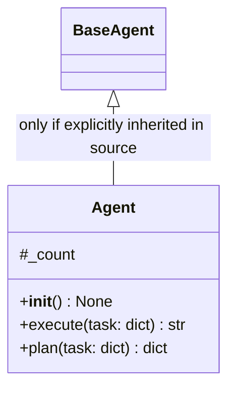

# Codex Implementation Specification — Python UML Code Canvas for VS Code

**Revision 3 CORE: all Revision 2 behavior retained, with mandatory Etchpad-inspired semantic navigation, abstraction levels, source-backed investigation and semantic Git diffs in Sections 15–24. AI explanations, AI walkthroughs and AI agent/CLI integration are explicitly DEFERRED and documented separately in `CODEX_PYTHON_UML_CANVAS_AI_DEFERRED.md`. Do NOT implement the deferred features in this release.**

**Historical Revision 2:** normative dependencies, test infrastructure, CI, and executable validation requirements (Sections 11–14). The full original sections follow unchanged.

You are a principal software engineer implementing **xp-code-canvas**, a production-oriented Visual Studio Code extension that treats a Python workspace as an interactive, UML-inspired code graph instead of a collection of separate source files.

**Implement the extension, not merely a plan.** You must deliver working, tested features in phased milestones, including a VSIX package. Do not invent your own diagram notation or interaction model. Follow the visual, behavioral, and technical contracts below. If an API constraint prevents an exact behavior, implement the closest supported behavior, document the constraint, and preserve the one-visible-surface design.

## 1. Product contract: ONE active editing surface

The central editor area contains **one visible work surface at a time**, switching between these views:

1. **UML Canvas** — a persistent VS Code webview *editor tab* that displays the Python code graph.
2. **Native Python Editor** — VS Code's normal text editor, opened at the selected class/function/method in the **same editor group**.

The UML node itself provides progressive detail: UML card -> rich UML with signatures -> scrollable, syntax-highlighted *read-only* source preview. From **any** node/detail level, an always-discoverable `Open in Editor` button (Codicon `screen-full` or `go-to-file`) switches to the native Python text editor at that symbol. The native editor has a `Return to UML Canvas` action (Codicon `graph` or `screen-normal`) contributed to its editor-title toolbar, plus a command-palette command and configurable keyboard shortcut. This is **bidirectional navigation** and should feel like zooming into and out of the same code.

**Do not create a permanent UML sidebar, bottom panel, second editor group, separate code preview panel, or a separate custom editor.** Do not forcibly hide a user's existing Explorer or other VS Code sidebars. An optional user-invoked distraction-free mode may hide sidebars, but restore prior visibility upon exit.

Implementation reality: VS Code does not support literally morphing a webview into its built-in text editor inside one tab. Use a **persistent webview editor tab** plus `vscode.window.showTextDocument` with `viewColumn` matching the canvas group and a `selection` range; return by `WebviewPanel.reveal`. Other tabs may exist in the tab bar, but only one editing surface is visible. Never close or overwrite unrelated editor tabs or unsaved text.

Navigation behavior:

- From canvas, clicking `Open in Editor` opens the real file at the symbol's accurate range, selects/reveals its name or declaration, and sets editor focus. Do **not** open `ViewColumn.Beside` by default.
- While in the normal text editor, `Return to UML Canvas` returns to the existing canvas, focuses the symbol under the current cursor (or the previously opened symbol if applicable), and restores the last viewport, expanded nodes, filters, file focus, and manually positioned nodes. Do not reset the graph layout.
- When the user edits code in VS Code, re-index changed files/symbols incrementally and update the canvas while preserving existing spatial state. Pending file changes must never be lost.
- Opening another Python file through the normal Explorer should work normally; track the active text editor and use that file as the focus the next time the canvas is opened. Add an explicit `Focus File in UML Canvas` Explorer context-menu action, since arbitrary single-click Explorer selection is not exposed as a general public selection event.
- The `Return to UML Canvas` command must work after user navigates elsewhere within the file or another Python file; highlight the current symbol and move focus as appropriate without destroying saved layout.
- Do not override native editor Ctrl+wheel zoom or core keyboard shortcuts. Use a discrete `Return to UML Canvas` command rather than attempting to intercept native editor scrolling.

## 2. Required behavior on the UML canvas

- Show the entire workspace at an appropriate level of detail; support multi-root workspaces and isolated focus neighborhoods. Represent files, classes, standalone functions, methods, and relationships with actual source data.
- **File focus:** when a file is focused, align that file's **top-level classes and standalone functions into a single vertical lane in source order**. File's methods normally appear inside their class compartments; allow explicit `Explode Methods` to show individual method nodes in a nested sublane. Keep callers and incoming dependencies to the left and outgoing dependencies/callees to the right as best effort; preserve edge routing.
- Alignment is a layout operation only. It **does not reorder Python source code**.
- **Dragging:** drag any card in both axes; connected edge endpoints track the card; retain manually pinned positions. Offer `Align Focused File`, `Unpin Selection`, `Reset Layout`, and `Fit View`. Never silently undo a user's manual positions when a file changes.
- **Expansion:** independently expand/collapse nodes without recentering the entire graph. Keep a node's world position anchored when its contents/size change; update edge handles and routing.
- **Semantic zoom:**
  - L0 overview: small, readable names and node-kind glyphs; selected relationship lines remain visible.
  - L1 structure: UML compartments, visible attributes/methods and signatures.
  - L2 code: the node grows to contain a scrollable **read-only, real-source** code preview, syntax highlighted in the VS Code theme.
  - A node may be explicitly expanded even when the whole canvas is zoomed out; explicit expansion overrides zoom-derived detail for that node.
  - A discrete `Open in Editor` control is always accessible by selecting/hovering a node, including at L0; from L2, double-clicking the source header may also open the editor.
  - Do **not** automatically open the native editor merely because the user crosses a wheel-zoom threshold; use an explicit action to avoid disruptive transitions.
- **Input gestures:** wheel on blank canvas zooms/pans according to documented settings; wheel over scrollable source preview scrolls that preview; Ctrl+wheel over source can zoom the canvas if configured. Dragging inside selectable code text must not drag the node. All controls keyboard accessible with visible focus indication.
- Search, filter by relation type, choose depth (`1`, `2`, `all`), hide library/external nodes, hover edge for evidence (callsite and source locations), select edges/nodes, jump to declaration. Minimap is optional and not a permanent panel.

## 3. Canonical UML visual language: DO NOT INVENT DIFFERENT SYMBOLS

The graph is **UML 2.5.1-inspired** for class/type relationships, with explicitly labeled custom extensions for Python modules, functions, imports, and calls. Standard UML class notation takes precedence for standard relationships. The whole graph is NOT falsely presented as a pure OMG UML class diagram because call graphs and file nodes are Python-specific extensions.

References:
- OMG UML 2.5.1: https://www.omg.org/spec/UML/2.5.1
- Mermaid class diagram conventional notation: https://mermaid.js.org/syntax/classDiagram
- PlantUML class diagram notation and examples: https://plantuml.com/class-diagram
- VS Code product/Codicon list: https://code.visualstudio.com/api/references/icons-in-labels

### 3A. Node family and shape contracts

**Module / Python file:**
- UML **package-like** shape: rectangle with a small tab in the upper-left corner (a conventional package symbol), header `«module» agent.py`, optional subtitle `my_package.agent`.
- VS Code Codicon: `symbol-module` (or `symbol-file` if file-focused).
- A module is a grouping/container, NOT a UML class. In global view, a module may collapse to a single group box; in file-focus view, use a subtle file lane containing its vertically arranged top-level symbols. Do not draw containment edges when visual nesting already communicates containment.

**Class:**
- Standard **three-compartment UML rectangle** with visible horizontal dividers:
  1. Header: class name centered/bold, with optional stereotype (`«abstract»`, `«protocol»`, `«dataclass»`). Abstract class name italic where appropriate.
  2. Attributes: one field per line, e.g. `- _client: Client`, `+ timeout: float`.
  3. Operations: one method per line, e.g. `+ execute(task: Task) -> Result`, `+ close() -> None`.
- Header icon: Codicon `symbol-class`; for verified Python `Protocol`, `symbol-interface` and `«protocol»`. For dataclasses use `symbol-class` and `«dataclass»`; no unique unstandardized silhouette.
- Compartment areas may be collapsed separately. If no reliable attributes, show none (do not fabricate them). If methods are exploded as nodes, keep the class's operations list as navigation entries, not duplicate graph identities.

**Standalone function:**
- Small rectangle with stereotype `«function»` (a documented Python-specific UML extension), `symbol-function` icon, full signature, return type if declared; optional docstring summary in L1; source in L2.
- `async def` shows `«async»` next to `«function»`, or a small `async` chip. The text/icon must carry meaning independent of color.

**Method:**
- Normally a row in the class operations compartment using `symbol-method`. On `Explode Methods`, render a `«method»` card connected by containment to its class grouping (or spatially nested in it), with own relation handles and source preview. Do not use separate method graph identities when the same method is shown in a class list and as a standalone expanded node.

**Attribute/property:**
- Attributes in the class middle compartment, `symbol-field` or `symbol-variable`; `@property` is shown as a property in the attribute compartment with `symbol-property`, not as an ordinary call method unless the user requests detail.

**Unknown/external target:**
- Compact, muted, dashed-border `«external»` or `«unresolved»` box with Codicon `question` or `symbol-reference`; distinct from confirmed nodes. Show provenance and reason on hover.

### 3B. Member visibility, decorators and typography

Use standard UML member visibility prefixes, with a truthful Python mapping:
- `+` public: no leading underscore; includes normal `__init__`, `__str__`, other dunder special methods.
- `#` protected by **Python naming convention only**: one leading underscore, e.g. `_initialize`.
- `-` private by **name-mangling convention only**: two leading underscores not ending with two underscores, e.g. `__secret`.
- `~` package/internal: supported as a UML symbol for external imported models, but do not infer this visibility from Python without reliable explicit metadata.
- Tooltip: Python visibility is conventional, not enforced access control. Never label dunder methods as private.

Display parameters and return types from source annotations; indicate missing types as unspecified (not invented `Any`). Display decorators accurately: `@staticmethod` has a `«static»` marker and UML underlining where practical; `@classmethod` gets a distinct `«classmethod»` marker (do not equate with static); `@abstractmethod` as `«abstract»`/italic; `@property` as property. Preserve `async` and decorators when previewing source.

### 3C. Edge notation and direction — exact legend

Standard UML edges:
- **Generalization / inheritance:** **solid line + hollow triangle arrowhead pointing at base class** (`Child --|> Base`). Use for explicit Python class bases; multiple inheritance means separate edges. `isinstance` calls do NOT create inheritance edges.
- **Realization:** **dashed line + hollow triangle toward interface/protocol** (`Concrete ..|> Interface`). Use only if a structurally meaningful explicit relationship is supported by evidence; mere conformance inferred from similarly named methods is not sufficient.
- **Association:** solid line, optionally directed with open arrow, if a real typed member/object reference is established and useful. Label association end with role/field name, multiplicity only when reliable.
- **Composition:** solid line with **filled black diamond at whole/owner end** (`Whole *-- Part`). Do not infer composition just because `self.x = Thing()` appears; object ownership/lifetime cannot generally be proved statically.
- **Aggregation:** solid line with **hollow diamond at whole end** (`Whole o-- Part`). Do not infer aggregation by default; enable only from explicit model annotations or user-defined overlays with provenance.
- **Dependency:** dashed line with open arrowhead toward depended-on element (`Client ..> Supplier`), with specific stereotype label where possible.

Python-specific dependency specializations (document as extensions, not standard UML association):
- **Calls:** dashed dependency arrow **caller -> callee**, labeled `«calls»`, with `callsite URI:line` in tooltip; show count badge for multiple callsites. Do not reverse direction. Detect `self.method()`, direct calls and cross-file calls when resolvable; mark ambiguous dynamic calls.
- **Imports:** dashed dependency arrow **importing module -> imported module**, labeled `«imports»`.
- **References:** dashed dependency arrow referencing symbol -> referenced symbol, labeled `«references»`; OFF by default for less clutter.
- **Instantiates:** dashed dependency arrow factory/function -> constructed class, labeled `«creates»` / `«instantiate»`; distinguish from ownership.
- **Decorates:** dashed dependency arrow decorated callable -> decorator target, labeled `«decorates»`; optional filter.
- **Contains:** spatial nesting (file -> top-level symbol; class -> member) is default, not a fake inheritance/association edge. When exploded nodes require an edge for clarity, render a subdued dotted `«contains»` non-UML organizational link and identify it as such.

Line conventions must not be conveyed by colors alone; use line types, arrowheads, stereotypes, and accessible legend. Parallel edges are separated/bundled with count and breakdown on hover. Unknown targets use dashed endpoints and uncertainty badge, never a false confirmed link. Do not infer runtime dispatch targets with unjustified certainty.

### 3D. Icon and action contract (Codicon IDs)

Node icons:
- module/file: `symbol-module` / `symbol-file`
- class: `symbol-class`
- protocol/interface: `symbol-interface`
- function: `symbol-function`
- method: `symbol-method`
- field/variable: `symbol-field` / `symbol-variable`
- property: `symbol-property`
- constructor: `symbol-constructor`
- unresolved/external: `question` / `symbol-reference`

Action icons:
- Open in Native Editor: `screen-full` (primary), tooltip **Open in VS Code Editor**
- Return to UML Canvas: `graph` or `screen-normal`, tooltip **Return to UML Canvas**
- expand/collapse: `chevron-down` / `chevron-right`
- pin/unpin: `pin` / `pinned`
- focus file: `target`
- align: `list-tree` or `layout`
- reset/recalculate graph: `refresh`
- zoom: `zoom-in` / `zoom-out`
- incoming/outgoing calls: `call-incoming` / `call-outgoing`
- uncertainty: `question`

In extension-host UI, use `vscode.ThemeIcon` for native commands. In the React webview, ship legally distributable theme-aware SVG/icons or bundle Codicon assets through the extension; do not depend on network fonts/CDNs. Respect the selected VS Code theme and high contrast.

### 3E. Pixel/interaction guidelines

- Class cards: three compartments with thin neutral dividers; dark/light/high-contrast themes, no hard-coded bright backgrounds.
- Header contains left kind glyph, centered or clearly dominant name, right-side `Open in Editor` control visible on hover/focus/selection (always keyboard accessible). At tight zoom, show a compact toolbar on selection rather than a tiny invisible hit area.
- Signatures monospace; names readable at L0, tooltips for truncated names. Never truncate unique identification without hover/accessible full label.
- Handles dock to card boundary, not to text rows. Edges reroute after resize, drag, or layout. Selected edge highlights both endpoints.
- Source preview: monospace syntax-highlighted read-only code from the **current VS Code TextDocument** (including unsaved changes), scrollable inside the node, accurate line numbers optional. Avoid duplicating language tooling or editing UI inside this preview.
- Keyboard: Tab navigation; Enter expand/select, dedicated open-editor command, accessible tooltips and ARIA labels; don't steal native editor shortcuts.

## 4. Canonical visual example

Source files:

```python
# api.py
from agent import Agent

def handle_request(data: dict) -> str:
    return Agent().execute(data)

# agent.py
from tools import search

class Agent:
    def __init__(self) -> None:
        self._count = 0

    def execute(self, task: dict) -> str:
        return search(task)

    async def plan(self, task: dict) -> dict:
        return task

# tools.py
def search(task: dict) -> str:
    return 'ok'
```

In file-focused `agent.py` mode, the diagram visually arranges **Agent** in the center file lane, **handle_request() / api.py** to the left (incoming), and **search() / tools.py** to the right (outgoing). `Agent` is a standard three-compartment class card; operations include `+ __init__() -> None`, `+ execute(task: dict) -> str`, `+ plan(task: dict) -> dict «async»`. `_count` appears as `# _count: int` ONLY if the type is directly supported by analysis (e.g. a safe type inference result), otherwise `# _count` with no fabricated type. At L2, opening `execute` displays its real code within the expanded card; clicking `Open in Editor` opens **agent.py in the same editor group**, at `execute`.

Expected relationship facts:
- `handle_request()` `«calls»` -> `Agent.__init__()` / or class instantiation edge to `Agent` (where resolution supports it).
- `Agent.execute()` `«calls»` -> `tools.search()`.
- `agent.py` `«imports»` -> `tools.py`.
- `api.py` `«imports»` -> `agent.py`.
- **NO** invented `Agent *-- search()` composition edge, or claim that `plan()` calls `search()`.

A Mermaid reference showing the standard class form (illustrative only — the actual UI uses React Flow, not Mermaid rendering):



This Mermaid relationship is **illustrative of arrow syntax only**: there is no `BaseAgent` in the supplied example and it MUST NOT be emitted from that example's code graph.

## 5. Analysis and graph model

- Use VS Code workspace/document APIs and language-feature providers (document symbols, definitions, references, incoming/outgoing call hierarchy) when available. Support a Python AST worker for deterministic symbol inventory, imports and direct syntactic callsites. AST parsing must **not execute or import arbitrary user code**.
- Do not require Pylance specifically; degrade gracefully if a provider is missing. Resolve references conservatively: separate proven, plausible/ambiguous and unresolved links, and include evidence with each edge.
- Suggested graph types: `GraphNode { id, kind, uri, qualifiedName, range, selectionRange, parentId, moduleId, decorators, visibility, parameters, returnAnnotation, sourceDocumentVersion, confidence }`; `GraphEdge { id, source, target, type, label, locations[], confidence, provenance }`; `ViewportState { zoom, x, y, focusedFile, activeNode, expandedNodeIds, pinnedPositions, filters }`. Use strongly typed TypeScript discriminated unions and schema versioning.
- Symbol keys should survive line shifts. Start with workspace-relative URI + qualified name + kind; implement conservative remapping on rename/move using source proximity/fingerprints and fall back to reidentification. Never assume that textual name alone is a globally stable ID.
- Respect multi-root workspaces, `.gitignore`, `files.exclude`, `search.exclude`, virtual environments and generated files. Bound traversal and use lazy graph expansion for huge repositories.
- Handle module-level functions, nested functions, methods, async functions, decorators, properties, overloads, aliases, Python protocols, dataclasses, abstract bases and multiple inheritance. Treat dynamic dispatch, `getattr`, runtime monkey patching and reflective imports as inherently uncertain when they cannot be resolved statically.
- No network upload or LLM calls are needed for the core graph. Index local source only, with no telemetry by default.

## 6. Implementation architecture

**Sections 11–14 provide the mandatory library selections, analyzer protocol, test systems, CI and definition of done; they take precedence over implementation suggestions here.**

- **Extension host:** TypeScript; commands; `createWebviewPanel`; `showTextDocument`; `WebviewPanel.reveal`; active document/cursor tracking; workspace trust, changes/renames; safe persistence. Native editor remains the source of truth.
- **Canvas:** React + TypeScript + `@xyflow/react` custom nodes, handles, edge components, viewport, grouping, drag/zoom; ELK.js for deterministic file-focus column and edge routing. Cache layouts and preserve pinned user positions.
- **Code preview:** lightweight, syntax-highlighted read-only source in webview. **Do not embed CodeMirror for editing in MVP**. Native VS Code editor handles edits, language server, completion, formatting, refactoring, breakpoints, debugging, undo/redo and save.
- **Analysis:** Python `ast` worker and VS Code symbol/language providers with a typed messaging bridge; no source execution. Optional LibCST only when there is a real later need for preserving refactorings, not for basic preview/navigation.
- **State:** retain canvas logical state through `webview.setState/getState` and workspace memento/versioned persisted workspace state; serializer for restoration after VS Code restart. Avoid `retainContextWhenHidden` unless proved necessary. Persist user pins/layout per workspace, not per arbitrary global filesystem.
- **Security:** strict webview Content Security Policy; no inline/eval scripts or network assets; sanitize code previews; consider workspace trust; use VS Code document API for current source; avoid executable imports during indexing.
- **Performance:** incremental/restartable indexing; cancel stale work; debounce rapid document edits; virtualization/lazy node detail; target thousands of symbols without freezing editor. Do not show stale source as current.

## 7. Required VS Code commands, menus, settings

Commands:
- `xpCodeCanvas.open`
- `xpCodeCanvas.focusCurrentFile`
- `xpCodeCanvas.focusFile` (accept Explorer resource URI)
- `xpCodeCanvas.openNodeInEditor`
- `xpCodeCanvas.returnToCanvas`
- `xpCodeCanvas.alignFocusedFile`
- `xpCodeCanvas.resetLayout`
- `xpCodeCanvas.fitView`
- `xpCodeCanvas.toggleExplodedMethods`

UI contributions:
- Command palette: Open UML Canvas; Focus Current File; Return to UML Canvas.
- Explorer context menu for Python files: Focus File in UML Canvas.
- Native editor-title command: Return to UML Canvas (only for Python documents when an associated canvas session is available).
- Canvas node overlay toolbar: Open in Editor, expand/collapse, pin/unpin, highlight callers, highlight callees.
- Canvas toolbar: search, edge filters, neighborhood depth, align, fit, legend, settings. No permanent auxiliary view.

User settings:
- `xpCodeCanvas.defaultSemanticZoom`, `xpCodeCanvas.showImportEdges`, `xpCodeCanvas.showCallEdges`, `xpCodeCanvas.showReferenceEdges`, `xpCodeCanvas.focusNeighborhoodDepth`, `xpCodeCanvas.explodeMethods`, `xpCodeCanvas.excludeGlobs`, `xpCodeCanvas.editorNavigationPreview`, `xpCodeCanvas.layoutDirection`.

## 8. Milestones (deliver runnable increments)

**Phase 1 — Real symbol inventory and standard UML visuals**
- Scaffold extension and webview; parse/resolve actual Python files; deliver module/package, class, function, method nodes; UML compartments and icons; real typed edges with evidence; visual legend.
- Unit tests on symbol inventory and notation semantics; smoke-test in Extension Development Host. Implement the required analyzer/unit/contract test infrastructure from §§11–14 in this phase.

**Phase 2 — Dynamic interactive canvas**
- File-focus vertical alignment, source order, incoming/outgoing neighbors; zoom, drag, pin, expand/collapse; edge attachment/routing; state persistence. Test that layout changes never modify code. Run Playwright browser gesture tests from §12B, not just jsdom simulations.

**Phase 3 — Read-only code preview and single-surface navigation**
- Semantic zoom L0-L2, scrollable node source; Open in VS Code Editor via same-group `showTextDocument` at exact symbol; Return to UML Canvas via editor-title action; restore canvas position/selection and follow changed cursor symbol. No extra panels or side-by-side editors. Test unsaved buffer previews and state restoration. Run the real-desktop ExTester golden path from §12D for native editor navigation.

**Phase 4 — Production quality**
- Incremental reindexing on edits, source version handling, multi-root, filters, cancellation, accessibility, performance budget, telemetry disabled, extension CSP, docs, packaging. All four automated layers from §12, Windows and Linux CI from §13, and full packaged-VSIX desktop coverage. Build `.vsix` and ensure it installs, launches, navigates and returns as specified.

## 9. Acceptance tests: must pass

1. On a Python workspace with `api.py`, `agent.py`, and `tools.py`, `Open UML Canvas` displays actual symbols and edges, not hard-coded diagram samples.
2. Focusing `agent.py` aligns its top-level symbols vertically in source order; related symbols from other files remain visible, and edges stay attached during animation.
3. A class card has the required header, attributes and operations compartments; Python visibility marker mapping and decorators are correct.
4. Inheritance arrowheads point to the base class; call arrows point to the callee; imports point to the imported module. Composition and aggregation are never hallucinated.
5. Dragging a node preserves pinned position and endpoint routing. Re-align uses source order without writing to Python files.
6. Semantic zoom changes actual content (not just CSS scale); expanded source is read-only, scrolls independently, and reflects unsaved VS Code edits.
7. `Open in Editor` from either overview or source-preview level opens the native VS Code editor **in the same editor group** and reveals the right range. **No new editor column, sidebar or panel** is created.
8. `Return to UML Canvas` restores the same graph tab and viewport, with node positions, filters and expansion states intact, and highlights the appropriate symbol.
9. Edits made in VS Code are shown in the UML source previews and graph after incremental analysis, with no loss of changes or false editing of another file.
10. Symbol resolution distinguishes proven, ambiguous and unresolved relationships; no guessed dynamic call graph edges masquerade as certain.
11. Supports keyboard operation, accessible labels, high contrast, light/dark themes and webview CSP.
12. Runs **all four** automated test layers in §12, the build/lint/typecheck/security/coverage gates in §13, and packages and verifies a valid VSIX; the README contains F5 Extension Development Host and installation instructions. `NOT RUN` or `BLOCKED` desktop UI tests are not a release pass.

## 10. Execution requirements for Codex

1. Inspect repository contents first; preserve relevant existing code if this is not a fresh repo.
2. Write a concise architecture decision record naming VS Code webview editor + native editor toggle, Python analysis approach, graph model, and UML notation. Do not waste time redesigning the explicitly defined interactions and symbols.
3. Implement the milestones in order. For each: code, tests, run tests/build, fix failures, then continue. Do not stop after writing the plan.
4. Create `docs/UML_VISUAL_LANGUAGE.md` by extracting the exact canonical node/edge/icon rules above, including examples and a permanent in-app legend. Keep documentation and UI behavior consistent.
5. Package and verify `dist/xp-code-canvas-<version>.vsix`; run the complete test matrix, store evidence in `docs/VALIDATION_REPORT.md`, report actual PASS/FAIL/BLOCKED/NOT RUN for each layer, and document all runnable developer commands.
6. §§11–14 are binding engineering and test contracts; do not treat them as optional recommendations.

**Non-goals in this version:** editing directly inside graph previews; an independent sidebar graph; interpreting unknown dynamic Python behavior as verified facts; auto-generating code from diagrams; replacing the standard VS Code Python text editor; AI-based graph discovery as a dependency.

## 11. MANDATORY technology stack and dependency policy

This section overrides any earlier wording that describes a library as merely a suggestion. Use the selected stack unless an objectively documented incompatibility prevents it; document the replacement and provide equivalent tests. Do NOT have Codex spend cycles designing a different framework stack.

### 11A. Toolchain and compatibility

- **Node.js:** Node 22 or newer LTS release compatible with pinned VS Code and all tooling; set `engines.node`, `.nvmrc` (or `.node-version`), and CI `setup-node`. Prefer Node 22 as the shared minimum unless dependencies require a higher LTS; do not silently float Node major versions.
- **Package manager:** npm with a committed `package-lock.json`; installation on developer machines and CI uses `npm ci`. Do not mix pnpm, yarn, and npm lockfiles.
- **TypeScript:** strict mode everywhere; separate `tsconfig` for extension Node host, shared contracts, React/browser, tests. `noImplicitAny`, `strictNullChecks`, `noUncheckedIndexedAccess` where feasible.
- **VS Code target:** current stable desktop API, with an explicit `engines.vscode` minimum chosen based on APIs actually used. Record and **pin the exact VS Code test version** for reproducible full-IDE tests; periodically test the latest stable separately. Do not use VS Code proposed APIs.
- **Python:** Python 3.11+ for the optional worker; target 3.11 and 3.13 in parser CI, use 3.12 as the Windows development baseline. Never import or execute project Python modules to build the graph.
- **Operating systems:** Windows 11 (primary developer target), Ubuntu (CI), macOS smoke compatibility when runner capacity allows. Use platform-independent paths and `spawn` rather than shell-joined commands; check paths with spaces and Unicode.
- **Reproducibility:** pin compatible package releases through `package-lock.json` (do not invent exact version numbers in this document); document `node --version`, `npm --version`, `python --version`, and VS Code version in `docs/DEVELOPMENT.md`. `npm ci`, not `npm install`, is the CI command.

### 11B. REQUIRED runtime and development libraries

| Layer | Required library/API | Exact role | Notes |
|---|---|---|---|
| Extension host | `vscode` built-in API; `@types/vscode` dev type package | Commands, document lifecycle, workspace access, editor/webview navigation, state storage | No replacement for native editing |
| Bundling | `esbuild` for extension host, `vite` for webview | Produce Node-host bundle and separate CSP-compatible browser assets | Webview bundle must not import Node modules |
| Canvas | `react`, `react-dom`, `@xyflow/react` | Graph viewport, custom UML nodes, ports, dragging, edges | Not Mermaid as interactive renderer |
| Layout | `elkjs` | Directed arrangement, focused-file lane and relationship routing | Deterministic inputs/order; pin positions outside recomputed lanes |
| Shared app state | `zustand` | Selected node, active focus, filters, zoom mode and pinned layout state | Keep graph serialization separate from React components |
| Runtime schema | `zod` | Validate extension↔webview messages, worker output, graph/state versions | Validate untrusted inbound messages, not only TypeScript interfaces |
| Code preview | `prismjs` Python grammar | Read-only syntax highlighting for real source text | Render tokens as React text nodes; never inject untrusted HTML via `dangerouslySetInnerHTML` |
| Icons | `@vscode/codicons` or locally bundled, licensed Codicon SVG/font assets | Use exact codicons prescribed in §3 | Offline, theme-aware; no remote icon URLs |
| Python inventory | Python standard library `ast`, `tokenize`, `json`, `sys` | Parse source supplied via stdin; inventory declarations/imports/calls | No pip dependency for production worker; do not execute source |
| Enrichment | VS Code document symbols, definitions, references and call hierarchy providers | Resolve semantics when providers are available | Never require proprietary Pylance in base tests; degrade gracefully |
| Packaging | `@vscode/vsce` | Produce VSIX with packaged browser and Python worker files | Validate VSIX contents, not merely that command exited 0 |
| Quality | `eslint`, `typescript-eslint`, `prettier`, `ruff` (Python) | Consistent lint/format/type hygiene | Document local commands and enforce in CI |

**Explicit exclusions for MVP:** do not add CodeMirror/Monaco inside nodes, Cytoscape, D3 as a second graph renderer, a custom LSP, Electron as an app dependency, SQLite, network APIs, server backend, AI graph inference, mandatory Pylance, or LibCST without a demonstrated requirement. Mermaid/PlantUML/OMG are reference **notations**, not the production rendering engine. No Python `pip install` is required for an end user with a working standard Python interpreter.

### 11C. Source analyzer worker and data protocol

Implement a small separate Python process, invoked with `child_process.spawn` and fixed argument array (no `shell: true`), e.g. `python -I -S -B -u <bundled-worker-path>` after validating executable/permissions and workspace trust. The extension supplies **current `TextDocument.getText()` contents**, not merely file paths, so unsaved buffers are indexed. Worker receives length-bounded **newline-delimited JSON** requests with `{ id, uri, version, source, pythonSyntaxVersion? }`, returns schema-validated JSON results `{ id, uri, version, symbols, imports, syntacticCalls, diagnostics }`. If the source may include newlines, JSON-escape it in the protocol. Enforce request-size and output-size limits, process timeout, cancellation and restart on crash. Reject stale versions; sanitize diagnostics; never execute or import workspace code. Handle missing Python and untrusted workspaces with useful errors and/or language-provider-only fallback. Never pass user code into a shell string.

Keep graph structure separate from drawing positions: a semantic graph (`GraphNode`, `GraphEdge`, callsite evidence) plus a versioned visual state (`pinnedPositions`, expansions, viewport). The worker is responsible for syntax evidence; VS Code language providers may enrich semantic resolution. Preserve confidence distinctions. Do not promise perfect resolution of Python's dynamic behavior.

### 11D. Codebase layout (required separation)

```text
xp-code-canvas/
  src/extension/          # VS Code host, command registration, documents, webview bridge
  src/domain/             # Graph types, semantic edges, stable IDs, validation, layout inputs
  src/analysis/           # Worker launcher, provider adapters, reconciliation, incremental cache
  src/shared/             # Zod message envelopes; stable wire contracts
  webview/src/            # React Flow canvas, custom UML nodes, semantic zoom and theme
  webview/harness/        # Browser-only fake VS Code bridge for Playwright, same production CanvasApp
  python/worker/          # stdlib AST parser, JSON line entrypoint (bundled in VSIX)
  python/tests/           # pytest fixtures and worker contract tests
  tests/fixtures/         # Immutable Python project fixture + expected semantic graph
  tests/unit/             # Vitest domain, layout, bridge and React tests
  tests/extension/        # @vscode/test-cli Mocha tests inside Extension Development Host
  tests/canvas-e2e/       # Playwright real Chromium UI interactions
  tests/desktop-e2e/      # ExTester + Mocha real VS Code UI flows
  docs/                   # Visual language, development, testing and architecture
  .github/workflows/      # PR validation, Windows desktop smoke, release packaging
  .vscode/                # F5 launch and debug configurations
  .vscode-test.mjs        # Version-pinned official VS Code extension test config
  playwright.config.ts
  vitest.config.ts
  extester.config.json
  package.json
  package-lock.json
  pyproject.toml          # Python developer-only test/lint settings
```

The test fixture remains outside the shipped VSIX. The browser-only harness must use dependency injection: production `CanvasApp` accepts a typed `CanvasBridge`, production bridge communicates with VS Code, test bridge is a deterministic in-memory message responder. **Do not add test-only backdoors in the shipped extension.** Separate unit-test helpers may be exported from non-packaged modules.

## 12. MANDATORY automated test architecture

Do not claim the extension is tested merely because TypeScript builds or a React mock renders. All four layers below must exist and pass; each tests a different boundary.

### 12A. Layer 1 — fast deterministic unit and contract tests

Libraries: `vitest`, `@vitest/coverage-v8`, `@testing-library/react`, `@testing-library/user-event`, `@testing-library/jest-dom`, `jsdom`, and Python `pytest`, `pytest-cov`. Use `@types/node` and `@types/mocha` as needed; do not run browser gestures in `jsdom`.

Required test cases:

- Python AST: module/class/function/method signatures, decorators, properties, async, nested definitions, dataclasses, protocols, relative imports, type annotations, constructor methods, Unicode, line endings and syntax errors.
- Real call evidence and classification: direct call, `self.method`, imported function, cross-file call, inheritance, aliases and ambiguous dynamic calls; assert exact arrows, confidence, labels and source coordinates from fixtures. **No fabricated calls, inferred ownership or false UML inheritance.**
- Parser safety: a fixture with a top-level side effect that would raise if imported MUST index without executing; malicious/oversize/invalid worker messages must fail safely.
- Stable IDs and incremental changes: unrelated whitespace, new source lines before a method, rename, file move, version conflicts, stale responses, interrupted/canceled indexing and cache invalidation.
- Graph/layout pure functions: deterministic layout, vertical file-focus ordering, incoming/outgoing lanes, pinned-node preservation, edge geometry, collapsed/exploded methods, cycles and multi-root IDs.
- UI components (rendered with RTL): exact UML compartments, visibility signs, semantic zoom content L0/L1/L2, codicon identifiers, keyboard accessible labels, toolbar action dispatch, filtering and source preview escaping. Verify no unintended editing control in L2.
- Wire protocol: Zod rejects invalid commands, malformed paths, version mismatches, unknown payloads and overlarge messages; safe serialization round trips.

Coverage gates: **>=90% statement/line and >=85% branch** coverage of domain/analysis/bridge logic (excluding generated bundles and fixtures); **>=90% Python analyzer line/branch** coverage. Coverage is not a substitute for the mandatory end-to-end scenarios. When a gate cannot be measured for a specific tool/runtime, describe why and enforce on the remaining instrumentable code; never report a fabricated percentage.

### 12B. Layer 2 — actual browser UI tests of the graph

Library: `@playwright/test` with **real Chromium**. Run the exact production `CanvasApp` under Vite in `webview/harness` using deterministic fake-bridge messages. This is NOT a fake graph implementation or a screenshot-only smoke test. `playwright.config.ts` starts the harness with `webServer`, fixed port, `reuseExistingServer: !process.env.CI` or equivalent, deterministic viewport and reduced-motion configuration. Use `data-testid` only for stable semantics, not to bypass functional interactions.

Mandatory pointer/keyboard tests in Chromium:

1. Load 3-file fixture and assert the correct class cards, rows, names and node handles.
2. Click a file and verify top-level class/function nodes form the centered vertical lane in file source order.
3. Drag a node by its header to new coordinates; assert persisted position, re-rendered edge endpoint attachment and lack of source edits. Reload harness state and verify pin restoration.
4. Toggle `Explode Methods`; verify methods have unique graph identities and the expected parent grouping.
5. Zoom overview -> structure -> source and validate content actually changes; explicitly expand a node independent of global zoom.
6. Scroll **inside** a long source preview; verify source scroll position changes but the graph viewport does not. Dragging code text must not drag the node. Canvas wheel/gesture should still work outside the preview.
7. Click a mock `Open in Editor` button and assert an exact typed bridge message contains document URI and source range; never show a second browser-based editor.
8. Expand and resize nodes; assert edges terminate at correct handles after React Flow recalculates sizes, including on high DPI/zoom.
9. Keyboard-only navigation and action buttons; light/dark/high-contrast CSS tokens; long signatures, Unicode names, XSS-looking source text escaped.
10. Screenshot selected canonical layouts and compare stabilized snapshots at a pinned viewport/theme/zoom. Treat pixel snapshots as supplemental, **not** the only assertions. Capture Playwright trace, screenshot and console errors on failure.

React Flow uses browser DOM measurements and interactions, so **do not substitute jsdom drag simulation for this layer**. Browser-only harness tests cannot prove actual VS Code editor navigation; that belongs to layers 3 and 4.

### 12C. Layer 3 — official VS Code Extension Development Host integration

Libraries: `@vscode/test-cli`, `@vscode/test-electron`, `mocha`, `@types/mocha` and `@types/vscode`. Use `.vscode-test.mjs` and pin a supported desktop VS Code version rather than silently changing tested versions. Compile extension test files for Node; run with `vscode-test` against a disposable fixture workspace and isolated user-data/extensions directories. GitHub Actions on Ubuntu invokes it under `xvfb-run -a`; Windows runs it normally. Ensure tests do not depend on a developer's local Python extension configuration or Pylance installation.

Mandatory real-API assertions:

1. The extension activates, registers all declared commands and creates exactly one webview editor surface for the canvas (never a permanent sidebar or second editor group).
2. Opening `agent.py` at `Agent.execute()` uses `showTextDocument` and verifies actual active editor URI, selection/range and editor group/column. No `ViewColumn.Beside` by default.
3. `Return to UML Canvas` reveals the existing canvas and preserves persisted state; reopening code at a different function and returning focuses that function.
4. Creating an unsaved `TextDocument` edit changes source previews and analysis results; test independently from disk contents to detect stale indexing.
5. Rename/move/update a file, switch active editors, close/reopen the canvas, restore serialized state and verify pinned positions survive where possible.
6. Test document change bursts and cancellation: no outdated version may overwrite a newer graph; no editor focus loops.
7. Test Python missing/provider unavailable, malformed worker output, workspace trust restrictions, worker crash and disposal; appropriate fallback/error, no code execution.
8. Verify active document, multi-root URIs, paths with spaces/non-ASCII, source range off-by-one, CRLF and `file:` URIs.
9. Verify package `activationEvents`, command contributions, context menu and editor title command when-clause gating using the real Extension Host.

**Important boundary:** this layer verifies actual VS Code API behavior; it does not prove a human can click the rendered webview controls. Layer 4 does that.

### 12D. Layer 4 — real desktop end-to-end UI tests

Libraries: `vscode-extension-tester` (ExTester), its Selenium-based Page Object API and Mocha. Install as a dev dependency, configure `extester.config.json`, pin an ExTester-compatible VS Code version and ChromeDriver combination. Use `extest setup-and-run` with compiled `.js` UI test files; test the **packaged VSIX**, not only a dev source folder. Use its VS Code Workbench/TextEditor/WebView page objects plus custom page objects/locators for the UML webview; don't hard-code VS Code internal DOM selectors outside the approved page objects. Capture screenshots on failure.

The **mandatory desktop golden path**:

1. Launch a clean, isolated VS Code desktop with the newly packaged extension and open `tests/fixtures/golden-workspace`.
2. Run **Open UML Canvas** using the actual UI command; assert a real webview editor tab contains actual parsed `api.py`, `agent.py`, `tools.py` nodes.
3. Select/focus `agent.py` using the real UI; verify its symbols align vertically and other file relationships remain visible.
4. Drag the `Agent` node and check the position and connected edges visually/structurally through the actual webview; zoom into `Agent.execute()` until its real source is displayed; scroll inside the source box.
5. Click the node's **Open in VS Code Editor** button and check the actual native Python text editor opens `agent.py` at `Agent.execute()` in the **same editor group**, without an extra column or permanent panel.
6. Edit the function **without saving**; click the native editor's **Return to UML Canvas** action; assert the original graph tab, zoom, viewport, selection, node positions, focus and source content are preserved/updated correctly.
7. Navigate to a different function in the native editor, return again, verify the graph focuses the new current symbol rather than a stale one.
8. Restart VS Code with the same test workspace and assert persisted layout/selection restores after graph reindexing (where VS Code restoration contract supports it).
9. Run smoke on dark, light and high-contrast themes; keyboard-only invocation, no injected HTML/script execution, no network dependencies.

Test fixtures and user-data folders must be isolated per test run and cleaned up. Test runner should treat a desktop launch or download failure as **environment failure**, never as a passed/waived test. Where CI cannot provision the GUI/ChromeDriver, mark the job BLOCKED (not green); do not claim full E2E validation. Test determinism matters more than asserting pixel-exact positions in native window chrome.

## 13. Test infrastructure, scripts and CI contract

### 13A. Required npm and Python commands

Codex MUST implement working commands in `package.json` (not examples with missing scripts):

```text
npm ci
npm run typecheck
npm run lint
npm run test:unit             # Vitest, coverage gate
npm run test:python           # pytest + pytest-cov, coverage gate, via configured Python
npm run test:canvas-e2e       # Playwright Chromium + Vite harness
npm run build                 # bundle extension and webview + copy Python worker assets
npm run test:extension        # @vscode/test-cli + @vscode/test-electron
npm run package              # @vscode/vsce -> dist/xp-code-canvas-<version>.vsix
npm run test:desktop-e2e      # ExTester against packaged VSIX in real VS Code
npm run verify:vsix          # inspect VSIX manifest, files and activation commands
npm run verify               # fail-fast orchestration of all mandatory phases
```

Add `npm run dev:webview`, `npm run test:unit:watch` and `.vscode/launch.json` F5 launch. Scripts should use `node` or cross-platform npm command execution; no Bash-only/PowerShell-only package commands. Provide `scripts/verify.mjs` if necessary for ordered orchestration; it must propagate nonzero exit codes and produce a machine-readable summary. Do NOT silently skip desktop E2E in `verify`; if running in a headless non-GUI environment, emit `BLOCKED: real desktop UI runner unavailable` and make the full verification status non-successful. It is acceptable to expose an explicit `verify:headless` reduced gate, but **never** label it full verification.

Example `.vscode-test.mjs` structure (adapt to compiled extension test paths):

```js
import { defineConfig } from '@vscode/test-cli';
export default defineConfig({
  files: 'out/tests/extension/**/*.test.js',
  version: '<PINNED_TESTED_VSCODE_VERSION>', // replace with a real tested version
  workspaceFolder: './tests/fixtures/golden-workspace',
  mocha: { ui: 'bdd', timeout: 30_000 },
});
```

The placeholder is a **configuration instruction**, NOT a literal usable version. Codex must replace it by resolving a supported current version, check compatibility with ExTester, and commit the selected version through a single documented config location. Install `@playwright/test` browsers with `npx playwright install --with-deps chromium` in Linux CI or `npx playwright install chromium` locally. Full UI testing with ExTester separately downloads a matching ChromeDriver.

### 13B. Fixture and oracle requirements

Create at least these fixture groups:

- `golden-workspace`: minimum `api.py`, `agent.py`, `tools.py` plus checked-in expected graph JSON (source paths relative to fixture root, canonical ordered nodes/edges with evidence; don't snapshot raw OS paths).
- `python-edge-cases`: inheritance and multiple inheritance, `Protocol`, `@dataclass`, `@property`, `@staticmethod`, `@classmethod`, overloaded methods, nested/async functions, conditional imports, aliases, relative imports, import cycles, dynamic `getattr` and unknown dispatch.
- `adversarial-workspace`: module that throws/has side effects when imported, invalid UTF-8/Unicode path cases as supported, embedded HTML/script-looking docstrings, huge strings, malformed syntax, symlinks/ignored directories, worker crash injection via test double.
- `editing-workspace`: unsaved changes, CRLF, renames, version conflicts, line shifts, duplicate names and repeated rapid typing.
- `large-workspace`: generated **deterministic** code fixture (e.g. 1,000+ symbols, hundreds of call relationships). Generate locally with a seeded script; do not check in huge third-party repositories.

The graph oracle must assert source coordinates and edge directions, not only node counts. Include negative expectations (e.g. `Agent.plan()` must **not** have a call edge to `search()`). Keep a **test taxonomy** file `docs/TEST_MATRIX.md` mapping §9 acceptance criteria to executable test file(s) and CI job names. Add a test that fails if a required golden-path scenario has no implemented test.

### 13C. GitHub Actions checks and operating systems

Create `.github/workflows/ci.yml` with non-optional PR checks:

1. `static-and-unit` on `ubuntu-latest`: Node pinned LTS, `npm ci`, formatting, lint, typecheck, Vitest coverage.
2. `python-analyzer` on `ubuntu-latest`: Python-version matrix 3.11 and 3.13 (and add current stable as compatible), pytest/ruff + coverage, no dependency on Pylance or workspace imports.
3. `canvas-browser` on `ubuntu-latest`: Playwright Chromium with installed dependencies; traces/screenshots on failure.
4. `vscode-host-linux` on `ubuntu-latest`: bundled extension, isolated test workspace, `xvfb-run -a npm run test:extension` (install `xvfb` if necessary).
5. `vscode-host-windows` on `windows-latest`: official Extension Host integration tests, Windows path and document semantics.
6. `desktop-e2e-windows` on `windows-latest`: `npm run package`, verify the VSIX, then ExTester real-editor golden path on pinned VS Code/ChromeDriver. Prefer running this as a required PR check if runners support the GUI; if provider infrastructure does not reliably expose a desktop, use a dedicated Windows GUI-capable runner and document it **before** calling the workflow complete. Do not replace it with headless browser harness tests.
7. `package-verify` on `ubuntu-latest`: `npm run package`, inspect VSIX to ensure the extension entrypoint, webview bundle, legal assets, Python worker, README/LICENSE and activation contributions are present. Upload the VSIX as a workflow artifact; publishing must require a separate gated release workflow.

Enable `workflow_dispatch` and add a scheduled newest-stable VS Code compatibility run. Cache npm downloads and VS Code/Playwright binaries keyed by versions; **do not** cache mutable workspace state between test runs. Collect test reports (`coverage/`, Playwright traces, ExTester screenshots, VS Code extension logs), upload artifacts even on failure. A test should not pass because dependencies failed to download or test files were not discovered.

### 13D. Performance, reliability, security and accessibility gates

- **Performance:** deterministic 1,000-symbol fixture; measure cold indexing, reindex one edited file, file focus layout, and re-render after drag/expand. Define baseline and per-platform budget in `docs/PERFORMANCE.md` after measuring the first working implementation; report hardware/CI environment, variance, p50/p95; fail only on measured repeatable regressions rather than an arbitrary unverified latency promise. Add cancellation and memory-growth checks on large fixture.
- **Security:** no network source upload; assert strict CSP with no `unsafe-eval`/unapproved remote resources; code preview never interprets source as markup; unexpected bridge payload fails schema validation; untrusted workspace handling; no shell injection; parser does not import code.
- **Accessibility:** keyboard path canvas node -> expand -> Open in Editor -> Return to Canvas; visible focus; meaningful accessible names; contrast in light/dark/high-contrast, reduced-motion behavior.
- **Stability:** no focus loops, no missing-edge jumps after node resize, no overlapping top-level nodes on align, no stale index update after an unsaved buffer version change. Record exceptions and fail tests on unexpected webview console errors.

## 14. Definition of done, evidence, and Codex operating rules

Codex MUST produce the following in the repository as actual files:

1. Complete extension source, bundled Python AST worker, webview and semantic graph state with architecture boundaries above.
2. Complete test sources and working runners for layers 1–4, with golden-fixture source and expected graph JSON. No TODO-only test placeholders and no mocks in place of tests that require real VS Code UI.
3. `README.md`, `docs/DEVELOPMENT.md`, `docs/TESTING.md`, `docs/TEST_MATRIX.md`, `docs/UML_VISUAL_LANGUAGE.md`, `docs/PERFORMANCE.md`, and `docs/ARCHITECTURE.md` including the actual installed libraries, selected versions and platform requirements.
4. `.vscode/launch.json` with F5 Extension Development Host and debugging of the extension/tests; `.vscode-test.mjs`; Vitest, Playwright and ExTester configurations; reproducible `package-lock.json`.
5. GitHub Actions CI; a validated `dist/*.vsix`; nonempty test report artifacts and executable acceptance tests.
6. A validation report `docs/VALIDATION_REPORT.md` listing **each** required command, exit code, platform, number of tests run, evidence artifact path, known gaps and coverage. Every required test suite must run at least one meaningful test; zero-tests-discovered is an error.

**Milestone sequencing:** phase 1 implements worker+unit+extension-host smoke; phase 2 adds browser interaction E2E; phase 3 adds bidirectional real editor integration and desktop UI golden path; phase 4 hardens coverage, cross-platform CI, security/performance and packaging. Stop progressing a phase if its tests fail; fix failures before continuing. Tests must be checked in alongside features rather than added at the end.

**Truthful completion status:** report `PASS`, `FAIL`, `BLOCKED`, or `NOT RUN` separately for each layer. A pass in Vitest/Playwright cannot be represented as a pass for real VS Code. If Codex runs in a cloud/headless environment without a Windows GUI, it must still implement and commit the desktop runner, demonstrate the headless layers, and report real desktop E2E as **BLOCKED** until actually executed on the Windows runner. Never invent passing screenshots, run counts, or test outputs. A release is ready only when all mandatory checks have actually passed, including packaged-VSIX desktop E2E.

**Authoritative references for implementation:**
- VS Code extension tests and CLI: https://code.visualstudio.com/api/working-with-extensions/testing-extension
- VS Code CI and `xvfb-run`: https://code.visualstudio.com/api/working-with-extensions/continuous-integration
- VS Code webview security: https://code.visualstudio.com/api/extension-guides/webview
- React Flow browser testing: https://reactflow.dev/learn/advanced-use/testing
- ExTester install, CLI and desktop support: https://redhat-developer.github.io/vscode-extension-tester/getting-started/installation/ and https://redhat-developer.github.io/vscode-extension-tester/guides/test-setup/
- VS Code Python environments extension API (optional integration): https://github.com/microsoft/vscode-python/wiki/Python-Environment-APIs
- Packaging: https://code.visualstudio.com/api/working-with-extensions/publishing-extension

---

# Revision 3 CORE — Additive Spatial Code Intelligence, Etchpad-Inspired Features (Normative Sections 15–24)

**Status:** REQUIRED extension of the complete Revision 2 contract. Sections 1–14 above are retained in full, without deletion, relaxation, or replacement. These additions build on UML/file alignment/native-editor navigation, not replace them. Codex MUST execute phases 1–4 and add core phases 5–7, validating the aggregate non-AI product. The deferred AI roadmap is non-normative for this release. Preserve original behavior, source-truth boundaries, security and test gates; never silently drop an existing capability.

**Research basis (2026-11-18):** The public Etchpad site at https://www.etchpad.ai/ advertises source-backed spatial code maps, four exploration altitudes, dependency wires, semantic Git change overlays, block inspection, caller/dependency exploration, spatial memory and a cross-language abstraction model. The site offers a waitlist; these are **publicly documented/promoted capabilities**, not independently verified release behavior. We borrow interaction ideas, **not** its code, assets, screenshots, trademarks or pixel-specific styling. Etchpad is inspiration, not a runtime dependency.

## 15. Non-regression contract and feature provenance

### 15A. What must remain intact from V2

The following remain mandatory, fully tested and independently usable, including when Git is unavailable:

1. A **single active editor surface**, alternating between a persistent UML webview editor tab and the actual native VS Code Python text editor, using the **same editor group**. No mandatory second editor column, sidebar, bottom pane, or second inline source editor.
2. A **real Python source-driven UML graph** with canonical modules/packages, class compartments, functions, methods, attributes, imports, inheritance, calls, references, ownership constraints, uncertainty and exact evidence as defined in §§1–5.
3. Focusing a file aligns its top-level classes and functions **vertically in source order**, with related incoming/outgoing dependencies visible; dragging, pinning, persistent layout and connections remain fully functional.
4. Semantic zoom L0–L2, independently expanded nodes, scrollable **read-only** syntax-highlighted source from current VS Code TextDocuments (including unsaved buffers), and explicit Open in Native Editor / Return to Canvas navigation at the right symbol.
5. Source-safe incremental re-indexing, multi-root support, search/filter/relationship navigation, icon and UML styling rules, keyboard/accessibility/CSP/security, repeatable VSIX packaging and **all four** automated test layers with Windows desktop coverage.
6. The fixed V2 implementation stack: TypeScript extension host, React, `@xyflow/react`, ELK.js, Zustand, Zod, Python `ast` worker and language providers, Prism.js, Codicons, Vite/esbuild; do not replace the UI or parser merely to emulate Etchpad. A Rust rewrite is NOT required.
7. **Entirely deterministic, local-first operation.** No AI service, account, CLI, model adapter, remote server, or cloud connection is necessary or permitted as a prerequisite for the core UML/navigation/Git functionality.

### 15B. Feature adoption crosswalk

| Public Etchpad concept | Mandatory adaptation for xp-code-canvas | Additional test evidence |
| --- | --- | --- |
| Open project locally / source-backed map | Existing workspace index, exact source evidence, instant document refresh, never execute source | Deterministic graph fixtures and unsaved-buffer tests |
| Architecture / Package / Module / Code altitudes | Four named *abstraction levels*, orthogonal to L0–L2 semantic zoom; preserve canonical UML at every level | Multi-altitude source graph invariants and state-retention tests |
| Dependency wires, same query at different levels | Aggregate real symbol edges into module/package edges with source-level drill-down and counts | Graph aggregation provenance and no-invented-edges tests |
| Spatial recall | Existing pins/viewport plus per-altitude layout and focus history | Reload, reopen, rename and Git comparison state tests |
| Block-level select/hover inspection | Inspect node/edge and highlight exact callers, usages, references, dependency paths and source ranges | Playwright graph interaction / real editor target tests |
| Read one scope at a time; reverse callers/dependencies | Reversible, in-place trace/focus mode, not a permanent extra panel | Direction, path, history and exit-focus tests |
| Change/commit/PR diff overlay | Source-aware Git semantic diff with added/modified/removed constructs and changed edges | Git fixture and real VS Code/UI diff tests |
| Language-independent visual model | Language-neutral graph schema/adapter boundaries; complete Python adapter is the initial shipping implementation | Adapter-contract and Python regression tests |

**Never** claim that Etchpad itself uses any particular dependency, algorithm, internal protocol, or API based only on marketing UI imagery. Our choices below are independent engineering decisions.

## 16. Four abstraction levels above the existing semantic zoom

### 16A. Explicit altitude control

A compact, keyboard-accessible toolbar **inside the canvas** has four levels: `Architecture | Package | Module | Code`. Use a segmented control, discrete buttons, wheel-with-modifier, and commands/keybindings; do not add a permanent navigator panel. The 4-level switch is a *structural abstraction change*; existing L0/L1/L2 semantic zoom within each graph level remains intact. In particular, **Code altitude at L2 continues to show the original read-only source inside a box**.

- **Architecture:** workspace roots, top-level Python package groups, high-level components identified from *real* containment/import/call structure. Show quantitative cross-boundary relationship summaries. Do not auto-invent logical services, business domains, microservices or architectural ownership from names alone. If user-defined grouping is supported, explicitly mark it as a view annotation, not inferred fact.
- **Package:** Python package/directory hierarchy, including regular packages, namespace packages, subpackages and modules. Distinguish Python importable package identity from filesystem folder; show namespace ambiguities and source roots honestly. Derived package-to-package dependency edges aggregate source edges.
- **Module:** individual Python files, their major classes/functions, imports and relevant external nodes. Keep the V2 `«module»` package-tab shape, canonical UML class compartments and exact relation types.
- **Code:** individual classes, methods, functions, properties and references/callsites; source snippets L2 and jump-to-native-editor. Show nested functions when discoverable. No speculative fine-grained control-flow diagram masquerading as a confirmed call graph.

Changing altitude **does not** reset pins, change code, switch editor groups, clear filters, or discard the file focus. The same selected semantic entity anchors navigation: e.g., function → owning module → owning package → module/function on descent. `Focus Current File` must still align the focused file vertically (automatically enter Module/Code as needed), preserving V2 behavior. Altitude navigation is reversible via Back/Forward and breadcrumbs displayed **within** the canvas toolbar (not a sidebar).

### 16B. Grounded edge aggregation and drill-down

An aggregate edge is NOT a new inferred relationship. It is a view over actual lower-level edges. For each aggregate edge, compute:

- `sourceContainerId`, `targetContainerId`, `relationTypes`, `memberEdgeIds`, `resolvedCount`, `ambiguousCount`, `unresolvedCount`, `distinctCallsites`, and `indexSnapshotId`.
- Display a count and labeled edge-type breakdown; follow a click into concrete source/target symbols, callsite ranges and evidence. Never convert an ambiguous lower-level edge into a confirmed aggregate edge.
- Ignore organizational containment self-edges and internal relationships when showing *cross-boundary* counts, unless explicitly toggled. Do not double-count repeated edges after alias/import expansion.
- Allow `Show Internal Edges` and `Show External Dependencies` filters, and reveal the exact symbols responsible for an aggregate relationship.
- If the analysis cannot attribute a call or import to a package reliably, expose `unknown`, not a plausible invented target. Counter totals must equal the underlying canonical edge set used by the view.

### 16C. Deterministic spatial layout and scaling

Use ELK.js for first deterministic placement from stable sorted semantic IDs and source order, with reproducible layout input and a stable seed policy. Overlay a user's pinned/manual positions without recomputing them away. Keep separate layout snapshots for each altitude, each workspace and selected focus modes; retain a readable shared geographic orientation across transitions when practical. Collapse/expand package groups without orphaning hidden edges (aggregate/ghost edge counts). Keep rendering performant on thousands of constructs using viewport virtualization, progressive level-of-detail, and worker-side aggregation. Never make the project unusable merely because a module imports many packages.

## 17. Code-construct interaction and reversible semantic traces

### 17A. Node and edge inspections

Selecting a file, class, function, method, field, property or edge must make the following available **on the canvas** (a transient popover, anchored HUD or node toolbar, not a permanent left/right panel):

- Canonical identity, absolute/relative source URI, precise declaration/selection range, signature/decorators and source-version stamp.
- Incoming calls, outgoing calls, imports, inheritance, references, constructors/usages, and evidence quality. For a field/property show *read* and *write* sites separately only when resolvable; otherwise group as `references`.
- Clicking any relationship highlights both endpoints and the exact line or source span that establishes it. For member usage, identify the *specific referenced member* rather than vaguely reporting the entire class.
- Counts for multiple callsites, named relationships and cycles, with grouped pagination/virtualization where appropriate.
- Actions `Explore Callers`, `Explore Dependencies`, `Show References`, `Trace Path`, `Pin`, `Expand`, `Open in VS Code Editor`, and `Back` / `Exit Focus` (only where applicable).

Selecting one symbol should emphasize first-degree neighbors and de-emphasize unrelated constructs without deleting them. Selecting an aggregate edge reveals the source-backed lower-level evidence. Hover actions must not interfere with dragging; keyboard access to all actions is mandatory.

### 17B. Single-scope focus / flipped dependency direction

`Explore Callers` creates a **reversible filtered projection** around selected node/construct S: present all confirmed incoming callers that reach S at selected depth (default one), with explicit ambiguous/unresolved indicators. `Explore Dependencies` reverses the lens, following outgoing `calls`/`imports`/`creates`/other selected edge types; label the direction prominently. Toggle between incoming/outgoing with one action while preserving selection and history. Do not confuse caller/callee directions, or assume runtime ordering from static calls. A path can include cycles; ensure cycle handling terminates.

- Record an in-canvas trail `previous scope → selected member → dependency direction` and support Back/Forward/Exit Focus. All state is **visual exploration state**; original graph remains accessible and intact.
- Allow `Depth 1`, `Depth 2`, `All (bounded and progressive)`, relationship-type filters, and manual trace start/end. If a path cannot be resolved, show a gap/unresolved hop, not a fabricated link.
- Click a callsite badge to open/read the **exact** current Python line in an L2 box or the native editor. When switching to native editor and back, the scoped focus and graph arrangement survive.
- `Show exact usages` must identify same-symbol references from language providers where possible, not regex matches to the same text/name. Surface provider/no-provider caveats.
- A scoped projection must never rewrite or permanently hide saved pins or graph topology; entering/exiting scope should be lossless.

### 17C. Interaction specification and discoverability

A single main canvas with lightweight overlays is still the default. Tooltips/popovers are transient, dismissible by Escape, available by keyboard and screen readers, and constrained to the viewport. Do not emulate Etchpad's screenshot panels literally. The V2 node action `Open in Editor` remains available at every altitude where a source-bound construct is selected, and opens the same-group native editor.

## 18. Source-backed Git semantic changes and architectural impact

### 18A. Diff modes and baselines

Add a **Compare** control inside the canvas. The supported baseline modes are:

1. `Working Tree vs HEAD` — saved working-tree changes and new/untracked files; show unsaved VS Code document modifications as a separately labeled **unsaved overlay**, not as if Git had seen them.
2. `Staged vs HEAD` — Git index comparison.
3. `Commit/Ref vs Commit/Ref` — arbitrary valid local Git revisions with selection UI, including branch comparison via merge-base when chosen.
4. `PR-style local comparison` — comparison of a locally fetched feature ref to its base/merge-base; **do not require GitHub credentials or claim remote PR data exists**. An optional GitHub provider integration may discover a PR/ref with explicit user authorization; the core feature must work with local refs.
5. `No overlay` — disable annotations and return to a normal graph without disturbing viewport or pins.

Support multi-repository/multi-root workspaces, working trees with renames/copies, added/deleted/untracked files, ignored files, malformed Python, detached HEAD, absent Git executable, rebases and source roots crossing repository boundaries. Gracefully report unavailable baselines. Repo discovery and Git commands must be scoped to the selected workspace/repo, invoked via explicit argument arrays (never shell interpolation), with bounded time/size and no network calls by default.

### 18B. Construct-level semantic diff, NOT merely line heatmaps

For each changed file, independently parse the baseline and target **without importing/executing project code**, and map old/new semantic constructs using stable identity + qualified name + source fingerprint + explicit rename/move hints. Represent:

- `added`, `removed`, `modified`, `moved`, `renamed`, `unchanged`, `ambiguousMatch` states on functions, classes, methods, fields/properties when detectable, and modules/packages.
- Changes to signatures, decorators, inheritance, imported symbols, actual function body, docstrings, module imports and individual edges. Identify a signature-only change separately from body-only when possible.
- Edges `added`, `removed`, `modifiedEvidence`, unchanged. A removed function/edge remains visible as an **ephemeral ghost/tombstone on the selected diff**, referencing baseline source content only; never present it as existing current code.
- Changed callsites, caller/callee impact and cross-module/package **structural effects** derived from real dependency paths; distinguish direct modifications from **potentially affected** dependents, not actual runtime/test failures.
- Unknown impact when dynamic dispatch prevents certainty. A failed parse keeps a labeled text-diff fallback and does not fabricate a valid semantic diff.

Status is shown with icon/shape/text + theme-aware color: e.g. `+ Added`, `~ Modified`, `− Removed`, `↔ Moved`, `? Ambiguous`, `! Potential impact`. Colors alone must not carry meaning. Affected paths are overlays (not canonical graph edges) and may be hidden independently. A diff detail popover links directly to the correct VS Code Git diff / native editor range, preferring built-in diff display without a permanent split screen requirement; a user explicitly opening the standard VS Code diff editor is acceptable as a temporary deliberate editing mode.

### 18C. Git/source truth and life cycle

- Distinguish Git **baseline** snapshots, on-disk working-tree snapshots and current unsaved VS Code TextDocument buffers. Display these three sources with explicit labels; never silently substitute a stale disk file for unsaved source.
- Track commit hashes, index hashes/file versions, relative paths, source ranges, and snapshot IDs. On any baseline or document change, invalidate/recompute impacted projections incrementally. Reuse canonical graph parsing logic for historical and current source.
- A purely whitespace change that doesn't modify a construct's semantic structure should be indicated as a textual-only change where appropriate; never hide that the file changed. Move/rename heuristics must report ambiguity when an exact match isn't justifiable.
- For removed constructs, `Open Baseline` opens a read-only virtual document with the exact baseline source; `Open Current` is available only when an actual current symbol exists. Do not create real deleted files to support diff navigation.
- Git failure (no repo, missing binary, invalid ref, permission denial) must not disable UML/normal navigation. Diff overlays can be switched off without deleting user layout.

## 19. Semantic analysis boundaries and language-neutral core contracts

Keep Python as the **complete first-class shipping language**. The model is language-neutral for future extension, but additional language analyzers are not required now:

- Define `LanguageAdapter` with `scanDocuments`, `parseSnapshot`, `resolveSymbols`, `resolveEdges`, `getContainers`, `mapSourceRange`, `getEvidence`, and `getDiffConstructs`. Return diagnostics and explicitly unsupported capabilities rather than guessed relationships.
- Implement the Python adapter using the existing `ast` subprocess and VS Code language providers. Support `__init__.py`, namespace packages, relative imports, aliases, source roots, locally discoverable editable installs, nested scopes, generators, `async`, decorators, protocols, class members and dunder semantics. Dynamic dispatch and runtime targets remain uncertain unless supported by evidence.
- Use immutable/versioned `GraphSnapshot`, `SourceEvidence`, `CodeReference`, `SemanticDiff`, `AnalysisDiagnostic`, and trace-query structures in the shared pure core. Do **not** add AI-specific schemas, agent protocols, or an agent-facing CLI in this release.
- Each graph entity and Git diff artifact refers to its canonical source snapshot or baseline. Distinguish unsaved VS Code document versions from saved working-tree files and Git blobs; cancel stale work and show diagnostic status without falsely advertising a fresh graph.
- `SourceEvidence` includes URI, exact source ranges, document-version-or-Git-blob identity, resolution kind/confidence, language, source adapter, and relevant supporting edge IDs. Keep the ambiguity of unresolved relationships.
- Keep a separate **persistent user-view state** for pins, manual positions, optional user-defined groups, view annotations, altitude/focus history and viewport. These are user navigation choices, never inferred source relationships or source edits.
- The graph indexing pipeline must not import/execute application code, run project plugins, call models, contact network services, or execute tests as a side effect. Conflicting analyzer/LSP evidence must result in transparent uncertainty, not a fabricated edge.
- Expose ordinary internal typed graph/query services for the canvas, traces and diffs; those services must not require a public command-line interface or a local IPC endpoint. Future integration is covered **only** in `CODEX_PYTHON_UML_CANVAS_AI_DEFERRED.md`.

## 20. Detailed canvas visual contract for abstraction, tracing and Git overlays

The original **UML 2.5.1-inspired shapes and edge semantics in §3 remain authoritative**. New layers only introduce the following treatments:

- **Altitude toolbar:** `Architecture · Package · Module · Code`, current-level indicator, `Navigate Up`, breadcrumb, and Back/Forward. Prefer verified official Codicons such as `layers`, `package`, `symbol-module`, `symbol-code`, `arrow-up`, `history`; validate availability and document substitutions.
- **Package grouping:** UML package-tab containers and subtle nested boundaries, with existing class/function/module cards unchanged. Module/Code file focus must continue aligning the selected file's top-level symbols vertically.
- **Edge focus:** original UML inheritance, calls, imports, composition and uncertain-edge notation. `Explore Callers` traverses incoming; `Explore Dependencies` traverses outgoing. Focus uses highlighting, opacity and evidence labels, not altered arrow direction.
- **Diff overlays:** accessible textual `ADDED`, `MODIFIED`, `REMOVED`, `MOVED/RENAMED`, `IMPACTED`, `AMBIGUOUS` with status icons and theme-aware colors. Removed constructs are baseline-only ghost nodes/edges; they are not current code. Changes do **not** create new UML relationship kinds.
- **Transient block inspector:** node/edge source identity, exact evidence and usages, incoming/outgoing controls, `Open in Editor`, and bounded scrollable reference lists. Dismiss with Escape; do not introduce permanent additional panels.
- **Scale and accessibility:** aggregate wires when zoomed out, show counts and evidence drill-down, use ARIA labels and accessible keyboard focus, high-contrast and reduced-motion support. Do not use color alone as the only indicator of meaning.
- **Single active editing surface:** new controls live inside the existing canvas or as transient popovers. Canvas → native editor → canvas remains in the same group. A user-requested built-in Git diff editor is an intentional, temporary review action, not a permanent panel.

Never reproduce Etchpad's proprietary visual styling or branding. Do not add any AI explanation cards, walkthrough HUD, agent controls, chat panels, model configuration, AI buttons, or placeholder AI menus in the current release.

## 21. Required additional modules, libraries and dependency discipline

All dependencies, tooling and constraints in §§11–14 remain normative. For the V3 core additions, use the existing TypeScript + React Flow + ELK.js + Zustand + Zod + Python `ast`/language-provider + Prism.js + VS Code Codicon + esbuild/Vite stack. **No additional graphical renderer or editor is needed.** Add these separate modules (path naming may follow established V2 structure):

```text
src/extension/git/GitRepositoryService.ts     # local Git executable, argv only, no shell interpolation
src/extension/git/GitSnapshotService.ts       # refs, index, worktree, unsaved buffer identities
src/extension/git/SemanticDiffService.ts      # compare source-backed constructs and relationships
src/shared/abstraction/aggregateGraph.ts     # derived package/module/architecture graphs
src/shared/abstraction/altitude.ts           # four structural abstraction levels
src/shared/diff/semanticDiffContracts.ts     # typed semantic diffs, provenance, ambiguity
src/shared/trace/traceGraph.ts               # reversible incoming/outgoing scoped projections
webview/src/features/altitude/               # in-canvas altitude navigation and breadcrumbs
webview/src/features/focusTrace/             # source-backed caller/dependency traces
webview/src/features/gitOverlay/             # statuses, baseline ghosts and impact display
webview/src/features/inspect/                # transient evidence inspector

tests/fixtures/git-history/                  # generated local repository and truth oracles
tests/fixtures/semantic-traces/              # exact graph relationships and callsite oracles
```

- **Git integration:** use the installed `git` through Node `child_process.spawn`/`execFile` with argv arrays, trusted workspace `cwd`, resource/time limits and no network activity. Supported VS Code SCM APIs may supplement it but undocumented Git-extension internals must not be the sole backend. No remote GitHub SDK required.
- **Semantic matching:** parse Git blobs and current files with the same Python AST pipeline. Compare signatures, bodies, imports, decorators, inheritance and grounded relationships using typed matching with version/snapshot evidence. Optional text diff helpers cannot replace semantic matching; ambiguous moved/renamed symbols must say so.
- **Portability:** Windows PowerShell and Linux shell test paths, spaces and Unicode paths, and independent workspaces must work. Preserve the existing package-lock and pinned test versions. Record any additional dependency and its license/rationale in `docs/ARCHITECTURE.md`.
- **Not in scope:** AI provider/SDK adapters; Codex or Claude invocation; agent-facing CLI; VS Code live-agent IPC bridge; prompt templates; AI annotations; walkthrough UI; model/secret settings; artificial provider mocks. Do not install or scaffold these until the deferred roadmap is activated.

## 22. Additional deterministic tests and CI requirements

### 22A. Fixture suites and truth oracles

Extend all V2 fixtures without replacing any:

1. **Altitude aggregation fixture:** namespace packages, normal subpackages, multiple source roots, imports and calls, cycles, external nodes, ambiguous edges and same-name modules. Check exact IDs, aggregation counts, directional drill-down, evidence and preservation of vertical file focus at all four levels.
2. **Semantic trace fixture:** direct/indirect/recursive calls, inherited members, `self.method()`, shared dependencies, dynamic dispatch and exact callsite locations. Assert correct incoming/outgoing behavior, no duplicate IDs, safe cycle termination, member/line accuracy and non-confusion of same-named symbols.
3. **Git-history fixture:** real local commits, staged/unstaged/untracked/unsaved changes, signature vs body modifications, import and edge changes, deleted/moved/renamed constructs, whitespace-only changes, detached HEAD, merge-base, malformed Python and conflicting changes. Assert source-backed labeled states, ghosts and conservatively labeled potential impact. Run offline on Windows and Linux.
4. **Performance fixture:** >=1,000 symbol benchmark plus large package groupings, changing Git baselines, substantial fan-in/fan-out and concurrent unsaved edits. Measure indexing, aggregation, diff, tracing and interaction p50/p95 and memory behavior with real outputs.

### 22B. Mandatory layer-specific tests

- **Vitest and pytest:** graph IDs, aggregation, deterministic layout, semantic diff matching, schema parsing, source evidence, snapshot invalidation, trace cycles, Python AST corner cases, negative examples. Preserve V2 coverage thresholds (>=90% core TS lines/statements, >=85% core TS branches, >=90% Python line/branch).
- **Playwright Chromium:** all four altitude levels independently of L0–L2 zoom, vertical focus after altitude changes, callers/dependencies reversal, trace history, diff badges/ghosts, inspector evidence, node dragging, source scrolling, accessibility, high contrast and reduced motion. Use actual production React canvas through the existing injected fake VS Code bridge and assert semantics, not screenshots alone.
- **Official VS Code Extension Host:** real documents with unsaved edits, Git service in actual fixture repos, stable navigation, single-editor-group transitions, commands, baseline changes and persistent graph/layout state. Never infer a passed real-editor test from passing browser harness tests.
- **ExTester packaged desktop VSIX on Windows:** full V2 golden path and, in that same test, `Architecture → Package → Module → Code`, callers/dependencies traces, switching Git baselines, opening a changed source location, returning to canvas, reopening VS Code and verifying preserved state. **No AI/mock-agent workflow is required or permitted** in this phase.

Additional required scripts (in addition to the existing scripts in §13):

```text
npm run test:altitudes       # hierarchy, edge aggregation, provenance and view state
npm run test:semantic-diff   # real Git fixtures and versioned construct delta oracles
npm run test:traces          # caller/dependency directions, cycles, evidence and exact paths
npm run test:canvas-e2e     # V2 canvas + new altitude/trace/Git behavior
npm run test:desktop-e2e    # packaged VSIX complete non-AI desktop golden path
npm run verify              # every V2 gate + these core V3 gates; no silent skips
```

Keep all original V2 GitHub Actions PR, Windows/Linux, official Extension Host, Playwright, ExTester and VSIX package jobs. Extend them with these cases. Add `git-integration` on Ubuntu and Windows; no account secrets or remote Git services required. Upload fixtures/results, Playwright traces, screenshots, coverage and an honest machine-readable validation summary. `docs/TEST_MATRIX.md` must map **every core row of §15B** and each §23C acceptance case to actual test files and CI jobs.

Documentation additions for this release: `docs/DIFF_SEMANTICS.md`, `docs/ALTITUDES_AND_TRACES.md`, and `docs/ETCHPAD_FEATURE_CROSSWALK.md`. The crosswalk covers only features implemented in this core version, explicitly recording status and deviations. AI docs/agent docs belong to the future roadmap, not current build or CI.

## 23. Implementation phases and end-to-end acceptance tests

### 23A. Core phases 5–7 (additive after the original phases 1–4)

Execute and validate V2 phases 1–4 **without narrowing any original behavior**, then:

**Phase 5 — Architecture/package altitudes, inspections and reversible traces.** Implement four structural levels with grounded edge aggregation, source drill-down, per-altitude spatial state, block inspection, caller/dependency projection and trace history. Tests: exact unit/pytest truth oracles, real browser interactions and VS Code Extension Host navigation.

**Phase 6 — Semantic Git diffs and change impact.** Implement worktree/staged/unsaved/commit/ref/merge-base comparisons, versioned construct and relationship changes, baseline ghosts, potential impact, source-range navigation and failure handling. Tests: local Git history on Windows/Linux, browser behavior and native VS Code editor transitions.

**Phase 7 — Core hardening, integration and final VSIX verification.** Enforce required security/CSP, keyboard access, performance and deterministic test infrastructure; update docs and release manifest; run `npm run verify` and real Windows packaged VSIX desktop tests on the **final core build**. Do not create the deferred AI features, CLI or IPC bridge to fill this phase.

### 23B. Cross-cutting rules

- Every UI relationship is derived from existing canonical source/edge evidence, including aggregation, focus traces and diff overlays. Visual layout, native editor navigation and UML notation remain unchanged in meaning.
- Separate source-derived graph state, Git comparison state and user layout/focus state. Ephemeral traces/diffs must close without losing pins, zoom, expanded nodes or the selected file.
- Do not create additional permanent editor panels, require remote infrastructure, execute workspace source while indexing, or turn guesses into confirmed relationships.
- All phases deliver compiling code and real tests. Record measured results honestly; `BLOCKED`/`NOT RUN` is not `PASS`.

### 23C. Mandatory V3 core acceptance criteria

1. `Architecture → Package → Module → Code` preserves selected entity context; original file-focus vertical alignment and independent semantic zoom still work.
2. Package/module edge aggregates equal the underlying concrete, source-evidenced relationships, with accurate direction and ambiguity on drill-down.
3. Dragging, pins, node expansion, L0–L2 zoom, filters, focus and same-group native editor round trip persist across abstraction changes, trace enter/exit and changing Git diff baselines.
4. `Explore Callers` on `Agent.execute()` returns actual incoming callsites, not outgoing `tools.search()`. `Explore Dependencies` reverses correctly; cycles terminate and uncertain calls remain uncertain.
5. Selecting a member or relationship reveals the precise source range and usages. Symbols with the same spelling in different modules never falsely cross-highlight.
6. A real local Git commit comparison labels a removed method as a baseline ghost, shows a changed function and new cross-module call, and distinguishes **potential impact** from confirmed source edits.
7. Working tree, staging area, arbitrary local refs, merge-base and unsaved editor overlays are accurately labeled and function offline. No Git executable/repository disables only the comparison feature.
8. Final installed VSIX passes every original V2 test and all V3 core tests on required Windows/Linux/real desktop layers. Report failed/blocked/not-run suites honestly; do not claim completion without actual evidence.

## 24. Deliverables, verification evidence and scope boundary

Codex MUST deliver the entire original V2 extension plus all V3 core functionality, real fixture repos, tests, CI checks, documentation and the final installable VSIX. In `docs/VALIDATION_REPORT.md` provide:

- All original §§1–14 requirement IDs, all non-AI §15B features and all §23C acceptance cases mapped to code, tests, CI job and actual measured result.
- Installed/pinned versions of libraries, supported Git/VS Code/Python versions, environment OS and dependency rationale. No model or coding-agent version is relevant to the current release.
- For each required command and OS, exit code, tests discovered/executed, coverage, performance numbers, failure/limitation and explicit `PASS`/`FAIL`/`BLOCKED`/`NOT RUN` status.
- Exact VSIX package path, proof of installing **that packaged build**, and results from real native VS Code editor → canvas round trips, altitudes, traces and Git diff navigation.

**Inspiration/reference, not code dependencies:**
- Etchpad public product page: https://www.etchpad.ai/
- VS Code SCM: https://code.visualstudio.com/api/extension-guides/scm-provider
- VS Code webview: https://code.visualstudio.com/api/extension-guides/webview
- UML 2.5.1: https://www.omg.org/spec/UML/2.5.1

**Explicit deferral:** Do not implement or test AI-generated explanations, AI architecture walkthroughs, AI agent integrations, agent inspection CLI, IPC bridge, AI model/provider adapters, or proposed AI edits in this release. Keep them out of dependency manifests, commands, menus, CI and release acceptance. Their future contract lives in `CODEX_PYTHON_UML_CANVAS_AI_DEFERRED.md`. This does not relax any non-AI feature or test in §§1–24.

**Final instruction to Codex:** Implement the complete non-AI V2 + V3 core product, run all mandatory validation, and package the tested VSIX. Do not stop after design/scaffolding, do not narrow UML/navigation/diff features, and do not implement anything from the separate deferred AI roadmap until explicitly authorized.
