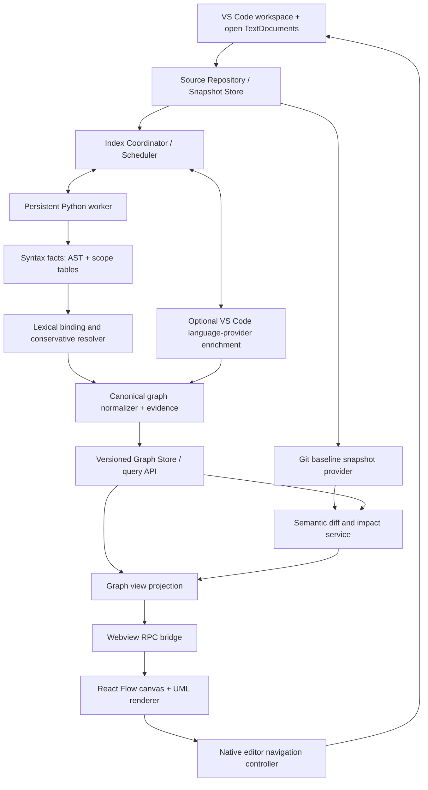

# XP Python UML Canvas — Production Architecture Review & Refactoring Blueprint (V4)

**Status:** architecture and migration design; **not an implementation**.
**Baseline audited:** `XP_Python_UML_Canvas_Starter_V1.zip`, `xp-code-canvas-starter` as supplied on 2026-11-19.
**Product requirements:** `specs/CORE_V3.md` remains normative. `specs/AI_DEFERRED.md` remains explicitly out of current scope.
**Audience:** Codex and experienced extension, Python tooling, and frontend engineers.

## 0. Executive architecture decision

**Evolve, do not rewrite.** Keep the Python standard-library AST, TypeScript, VS Code Extension API, React Flow, ELK.js, Zustand, Zod, the familiar UML notation, Git semantic comparisons, and the one-active-editor flow. Replace the monolithic analysis and lifecycle paths with a well-defined **Source Snapshot → Syntax Facts → Scope/Resolution → Canonical Semantic Graph → View Projection → Interactive UML** pipeline.

Do **not** implement a custom Python lexer/parser. Do build a custom **symbol binding, evidence, graph identity, projection and versioning layer**. Add the public VS Code language-provider APIs as an *optional enrichment provider*. Do not depend on private Pylance internals. LibCST is an optional later add-on for precise refactoring, not a reason to replace the native VS Code text editor or a prerequisite for source read-only previews.

### Non-regression contract

- Preserve V3's architecture/package/module/code abstraction levels, standard UML notation, real edges, file-focused vertical alignment, free dragging and pinning, dynamic line attachment, caller/dependency tracing, semantic Git diffs, and uncertainty labels.
- Preserve the user-facing **single active editor surface**: the UML tab and native Python editor replace/focus one another **in the same editor group**, with Return to Canvas restoring the viewport and focus. No permanent extra sidebar and no embedded code editor.
- Preserve read-only syntax-highlighted source preview inside expanding UML boxes and real unsaved VS Code documents as source of truth.
- Keep AI explanations, AI guided architecture walkthroughs, and agent-facing graph/CLI integrations **out** of the core. No speculative AI hooks, feature flags or placeholder modules.
- The project remains local-first. The extension does not import or execute user project Python code for analysis and does not upload user source.

## 1. Audit: code-backed findings

| ID | Location | Observed starter behavior | Production risk / remediation |
|---|---|---|---|
| F01 | `python/analyzer.py::build` | Full-workspace AST parsing and resolution are performed in one function (~200 lines of algorithm). | Unclear ownership, limited test isolation. Split parser, fact extractor, scoped binder, resolver and graph builder. |
| F02 | `python/analyzer.py::Calls.visit_Call` | `from b import helper; def call(helper): helper()` creates a false edge to `b.helper`. **Reproduced.** | Critical: semantic edges must honor lexical scope and shadowing. |
| F03 | `python/analyzer.py::stable_id` | Two declarations of the same name/kind in one file create duplicate node IDs. **Reproduced.** | React Flow collisions, ambiguous navigation and wrong diffs. Introduce declaration-instance IDs and stable reconciliation. |
| F04 | `python/analyzer.py::build` | Syntax error in one file causes all symbols from that file to disappear. **Reproduced.** | Typical temporary edits make UML vanish. Keep last-good snapshot marked STALE and disable invalid navigation; later add error-tolerant parser behind interface if justified. |
| F05 | `python/analyzer.py::source` | `ast.col_offset`/`end_col_offset` are UTF-8 **byte** offsets, passed directly to VS Code UTF-16 positions. | Misnavigation and inaccurate edge evidence for non-ASCII text. Centralize UTF-8 ↔ UTF-16 conversion and test emoji/non-BMP. |
| F06 | `python/analyzer.py::make_node` | Module holds full file text; class and method nodes hold overlapping code slices. | Repeated multi-KB source in graph payload, memory and webview IPC overhead. Keep ranges/hashes in graph; request source snippets on demand from documents. |
| F07 | `src/extension/extension.ts::documents/refresh` | All source documents opened and fully parsed again on each keystroke debounce; hard 350-file limit. | UI stalls, process churn, inability to handle regular projects. Incremental file cache and persistent worker(s), non-blocking indexing. |
| F08 | `src/extension/pythonWorker.ts` | A new Python interpreter is spawned for every index; environment inherited; 20-second timeout for whole workspace. | Startup overhead, cancellation race, interpreter drift. Persistent bounded worker protocol; `python -I -S` when supported; restart/backoff. |
| F09 | `src/extension/extension.ts::CanvasController` | Combines indexing, navigation, Git, session storage, command handling, webview, errors, lifecycle. | Hard to test and change. Use composition root plus small services with ports/interfaces. |
| F10 | `src/shared/types.ts` and `contracts.ts` | Graph schema v1, permissive `.passthrough()` fields; UI-origin messages not runtime validated; no request/revision IDs. | Stale messages and protocol drift. Versioned discriminated message schemas, bounded payloads, correlation, cancellation, acknowledgments. |
| F11 | `src/webview/App.tsx` / `store.ts` | React Flow node state and Zustand canvas state both influence positions; extension memento + `acquireVsCodeApi().setState` both persist state. | Lost drag positions, racing hydration, state divergence. One canonical session owner and explicit view-only state projection. |
| F12 | `src/shared/graph.ts::aggregateGraph` | Aggregates overwrite semantic node properties by cloning an arbitrary original node as a synthetic module. | Invalid ranges/parents and awkward future altitude semantics. Introduce separate `ViewNode`/`ViewEdge` types. |
| F13 | `src/extension/gitSnapshot.ts` | Git baseline reads each file via a separate `git show` subprocess; 350 file limit. | Latency and resource scaling. Batch blob requests / caching, semantic diff only impacted files. |
| F14 | `semanticDiff.ts` | AST hash is computed for nested nodes as part of parent bodies; edge identity merges repeat call sites. | Noisy changes and loss of call-site multiplicity. Separate signature/body/relationship hashes and evidence site IDs. |
| F15 | `.github/workflows/ci.yml` | `npm install` creates lockfile during CI; no committed `package-lock.json`; desktop UI suite is not a CI gate. | Non-reproducible releases; tests listed but not proven. Pin lockfiles, `npm ci`, actual UI evidence and a binary smoke test. |
| F16 | `docs/VALIDATION_REPORT.md` | Only Python and pure-TS checks were executed; npm/VS Code UI build, packaging and desktop navigation were unexecuted. | Starter must not be described as shipping-ready. Keep honest pass/fail/BLOCKED release reporting. |
| F17 | `src/extension/extension.ts::onDidChangeActiveTextEditor` | Changes `focusedFile` in memory but does not notify canvas immediately. | Focus in native editor can drift from canvas until another action. Explicit event and selection synchronization. |
| F18 | `src/shared/layout.ts::realignFile` | When passed aggregated view at architecture/package/module altitude, there are no class/function nodes to realign. | Inconsistent UX. Commands operate on canonical session/source identity and reproject per altitude. |
| F19 | Workspace source roots | `module_name` assumes each workspace folder root is the Python import root. | Incorrect modules for `src/`, namespace packages, multi-root repos. Discover configured roots with deterministic precedence and diagnostics. |
| F20 | Workspace trust / remote | Subprocess Git and Python are largely local-fs/desktop assumptions. | Incorrect behavior in SSH/WSL/virtual workspaces; untrusted code startup risk. Explicit platform capabilities and trust policy. |
| F21 | `python/analyzer.py::make_node` | Source preview for decorated methods omits decorators (`@staticmethod` does not appear in node `source`). **Reproduced.** | User sees incomplete source. Derive declaration preview from verified source range including decorators; never use AST selection range as a substitute for full source span. |
| F22 | `python/analyzer.py::edge` | Two calls to the same target on one line collapse to one edge with one evidence record. **Reproduced.** | Incorrect usage counts and incomplete trace evidence. Introduce unique callsite IDs and preserve every source span. |

All items above are findings from **inspection**; F02–F04 and F21–F22 were additionally reproduced with small direct analyzer probes. The 13 original Python tests still pass. There is no claim that the full extension was compiled or run.

## 2. Architecture: five distinct responsibilities



**Rule:** Source facts and resolved semantic graph are **not** UI state. View projection and physical layout are **not** source facts. A Git overlay is **not** a mutation of the current graph. Selection, pins, zoom and panel lifecycle are **not** held by the parser.

### Dependency direction

`contracts/domain` ← `analysis/app services` ← `VS Code adapters/composition root` and `webview projections/components`. Only the VS Code adapter imports `vscode`. Only Python code imports `ast`. Only webview implementation imports React Flow. No UI data structure reaches the Python worker.

### Ports and adapters (small, not a distributed microservice architecture)

```ts
interface SourceRepository {
  capture(uri: string): Promise<DocumentSnapshot>;
  listWorkspaceFiles(): Promise<SourceDescriptor[]>;
  changes(): AsyncIterable<SourceChange>;
}
interface AnalysisProvider {
  readonly id: 'python-ast' | 'vscode-language';
  analyze(documents: DocumentSnapshot[], signal: AbortSignal): Promise<AnalysisFacts>;
}
interface SemanticGraphRepository {
  getSnapshot(workspaceId: string): Promise<GraphSnapshot | undefined>;
  applyDelta(delta: GraphDelta): Promise<GraphSnapshot>;
  query(query: GraphQuery): Promise<GraphQueryResult>;
}
interface GitSnapshotProvider {
  capture(workspaceId: string, revision: string | 'INDEX'): Promise<SourceSnapshotSet>;
}
interface ViewSessionRepository {
  load(workspaceId: string): Promise<ViewSession>;
  save(workspaceId: string, state: ViewSession): Promise<void>;
}
```

These are **in-process** abstractions for dependency injection and test doubles, not public APIs or plugin systems.

## 3. Repository organization

Keep a single repository with explicit module boundaries; avoid publishing five separate npm packages prematurely. Use TypeScript project references or import-boundary rules to enforce those boundaries. Recommended layout:

```text
xp-code-canvas/
  apps/vscode/
    package.json                    # extension manifest, commands, packaging
    src/activate.ts                 # thin composition root
    src/commands/registerCommands.ts
    src/controllers/CanvasController.ts
    src/controllers/NativeEditorNavigator.ts
    src/adapters/VsCodeSourceRepository.ts
    src/adapters/VsCodeLanguageProvider.ts
    src/adapters/VsCodeViewSessionRepository.ts
    src/adapters/LocalGitRepository.ts
    src/adapters/PythonWorkerClient.ts
    src/platform/WorkspaceCapabilities.ts
    src/webview/WebviewHost.ts
  packages/core/
    src/contracts/graph.v2.ts       # pure runtime-checked schemas
    src/contracts/messages.v2.ts
    src/model/semantic.ts           # source facts, symbols, evidence
    src/model/view.ts               # projected nodes, edges, layout
    src/graph/GraphStore.ts
    src/graph/GraphValidator.ts
    src/graph/GraphQuery.ts
    src/graph/projection.ts
    src/graph/semanticDiff.ts
    src/graph/impact.ts
    src/layout/fileFocus.ts
    src/layout/layoutState.ts
  packages/application/
    src/indexing/IndexCoordinator.ts
    src/indexing/DocumentSnapshotCache.ts
    src/indexing/ResolutionCoordinator.ts
    src/indexing/GraphTransaction.ts
    src/navigation/NavigationService.ts
    src/git/GitCompareService.ts
    src/session/SessionService.ts
  apps/webview/
    src/app/App.tsx
    src/bridge/ProtocolClient.ts
    src/features/canvas/CanvasPage.tsx
    src/features/canvas/UmlNode.tsx
    src/features/canvas/UmlEdge.tsx
    src/features/canvas/ViewportController.ts
    src/features/filters/*
    src/features/focus/*
    src/features/inspector/*
    src/features/git-diff/*
    src/state/viewStore.ts
    src/styles/*
  python/
    pyproject.toml                  # isolated, testable, **not** published by default
    src/xp_canvas_analysis/
      __main__.py                   # worker protocol/entry point only
      protocol.py
      snapshots.py
      syntax/ast_parser.py
      syntax/symbol_extractor.py
      syntax/source_positions.py
      semantics/scopes.py
      semantics/imports.py
      semantics/calls.py
      semantics/inheritance.py
      semantics/evidence.py
      graph/build.py
      graph/identities.py
    tests/unit/*
    tests/contracts/*
    tests/fixtures/*
  tests/
    unit/*
    contract/*
    integration/*
    browser/*
    desktop/*
    fixtures/python-projects/*
    fixtures/git-history/*
    performance/*
  docs/
    adrs/*
    architecture/*
    CODEX_EXECUTION.md
    VALIDATION_REPORT.md
  specs/CORE_V3.md
  specs/AI_DEFERRED.md
  .github/workflows/*
  package-lock.json
  package.json                      # npm workspace scripts; pinned toolchain
```

The existing `src/shared/graph.ts`, `layout.ts`, and `semanticDiff.ts` should move, mostly intact, into the pure core package **after** splitting semantic graph from view projection. The existing React components are retained and extracted into smaller feature modules. `python/analyzer.py` becomes the compatibility entry point temporarily; eventually replace with the packaged worker entry point.

## 4. Graph and source contracts: make correctness explicit

### 4.1 Two graph layers

**Canonical semantic graph** — what source analysis can prove: document snapshots, declarations, imports, call sites, definition/usage edges, type information when available, provenance, uncertainty, diagnostics. **Never** stores x/y positions, selected status, styling, source text, or any React Flow object.

**Projected view graph** — what the user sees: package/module/group cards, a class's methods compacted into compartments, aggregated edges, explosion/semantic-zoom state, ephemeral removed-ghost display and visually routed connections. Each view element has a lossless mapping to canonical entity IDs/evidence IDs. No synthetic view node masquerades as a real Python declaration.

### 4.2 Recommended v2 data contracts

```ts
interface DocumentSnapshot {
  workspaceId: string; uri: string; language: 'python';
  sourceOrigin: 'open-buffer' | 'disk' | 'git-commit' | 'git-index';
  documentVersion?: number; contentHash: string;
  // Source bytes live in SourceRepository, never in graph JSON.
}
interface SourcePosition { line: number; utf16Column: number; }
interface SourceSpan { start: SourcePosition; end: SourcePosition; }
interface SourceRef {
  uri: string; documentVersion?: number; contentHash: string;
  span: SourceSpan; selectionSpan: SourceSpan;
}
interface Symbol {
  id: string; identityVersion: 2; workspaceId: string;
  kind: 'module' | 'class' | 'function' | 'method' | 'property' | 'external';
  moduleId: string; parentId?: string; name: string; qualifiedName: string;
  location: SourceRef; signature?: string;
  hashes: { signature: string; body: string; structure: string };
  modifiers: string[]; stereotype?: string;
}
interface RelationshipEvidence {
  id: string; source: SourceRef; producer: string;
  reason: string; confidence: 'resolved' | 'possible' | 'unresolved';
}
interface Relation {
  id: string; fromSymbolId: string; toSymbolId?: string;
  kind: 'imports'|'calls'|'creates'|'inherits'|'references'|'contains'|'realizes';
  evidence: RelationshipEvidence[];
  resolution: 'exact' | 'candidate-set' | 'unresolved';
  candidateIds?: string[];
}
interface GraphSnapshot {
  schemaVersion: 2; workspaceId: string; revision: number;
  sourceVersions: Record<string, string>; symbols: Symbol[]; relations: Relation[];
  diagnostics: AnalysisDiagnostic[]; availability: 'complete'|'partial'|'stale';
}
```

**Important contract rules:**

1. Source positions exchanged with VS Code must use **zero-based UTF-16 code-unit columns**, never raw Python AST byte offsets.
2. Symbol identities are unique **per declaration occurrence** even if Python redefines the same name. Use a declaration discriminator plus reconciliation from previous snapshots; do not assume `qualifiedName` alone is unique. Across renames/moves, report tentative correspondence separately from confirmed identity.
3. Relationship identity is separate from individual call-site evidence; repeated calls preserve evidence multiplicity. No directed edge without evidence or an explicit synthetic/aggregate flag.
4. A syntax-only resolution cannot claim to know dynamic virtual dispatch. If multiple targets exist, keep candidate IDs and mark possible; never pick one as certain.
5. Model unresolved calls as unresolved **facts** (or optional external presentation nodes), not as silently missing relationships.
6. `documentVersion` and `contentHash` must be checked before navigating a stale range or showing a preview. A stale graph can remain visible, but is visibly marked and actions revalidate/resolve before proceeding.
7. Graph validators enforce unique IDs, valid parents, valid source/target references, legal edge types, valid source ranges, bounded strings, and no dangling edges except explicitly unresolved facts.
8. A Git baseline is an immutable **separate graph snapshot**; a Git change overlay must not replace the current live graph as canonical state.

### 4.3 Source previews are requests, not giant graph fields

The node stores `location` and metadata. On expansion, the webview requests a bounded source preview by symbol ID and expected snapshot version. The extension loads the matching **unsaved TextDocument** when available, verifies the version and responds with text, line numbers, actual source span, and current/stale marker. Invalidate or refresh preview on document change. Never send all project source as part of `GraphSnapshot`.

### 4.4 Incremental protocol

Use a versioned, discriminated request/response envelope with `protocolVersion`, `requestId`, `workspaceId`, `graphRevision`, `documentVersion` when relevant, and typed `payload`. Define message schemas with Zod at the webview boundary and Python's built-in validation (or typed dataclasses) at the worker boundary. Distinguish requests (`sourcePreview/get`, `navigation/open`, `graph/query`, `view/statePatch`), events (`graph/snapshot`, `graph/delta`, `document/stale`, `navigation/focus`) and replies (`request/ok`, `request/error`). Avoid command strings encoded in status messages such as `#action:align`.

Apply graph deltas only if `baseRevision === currentRevision`; otherwise request a full snapshot. Drop out-of-order responses by request ID and document version. Use bounded queue capacity and cancellation. Keep a full-snapshot recovery path and a temporary V1 adapter during migration.

## 5. Python analysis pipeline — no homegrown Python grammar

### 5.1 Four deterministic stages

**Stage A — Parse and discover (Python `ast`, optional `symtable`).** Parse documents in isolation, inventory lexical declarations, parent/child relationships, decorators, imports, class bases and call-site syntax; emit raw facts with source spans and parse diagnostics. AST does not execute source. Python's standard-library `symtable` can help with local/global/free-variable classification, but do not treat it as runtime type inference.

**Stage B — Bind names and imports.** Build lexical scopes for function parameters, local assignments, `global`, `nonlocal`, closures, comprehensions, classes, imported aliases and shadowed names. Map module names using configured/discovered source roots (`src/` layout, `__init__.py`, namespace packages, multi-root). If a call name binds to a parameter or local alias with unknown value, do not reuse an imported declaration just because the text matches.

**Stage C — Resolve conservative semantic relationships.** Link only statically provable imports, definitions, local names, exact constructors, explicit superclass relationships and direct calls. For `self.method()`, distinguish statically known declaration from possible dynamic overrides; use candidate-set/possible where needed. Do not assume `variable.method()` resolves from syntax alone. Preserve unresolved facts with callsite text and reason.

**Stage D — Enrich using public editor language providers.** Optional provider asks VS Code for definitions/references/call hierarchy for *selected or visible* nodes and reconciles returned URIs/ranges against canonical declarations. No private Pylance APIs, no dependence on particular installed language server, and no requirement that language providers exist to render the AST graph. Track provenance per provider and never downgrade a proven fact silently.

### 5.2 Invalid Python while editing

On failure, preserve **last-known-good facts for that file only** with a `stale` flag and diagnostics. Mark ranges unsafe for direct navigation; revalidate against the current document or navigate to closest current symbol text if proven. Do not retain an old cross-file relationship as resolved without flagging staleness. Other files keep updating. A tolerant Tree-sitter parser may be evaluated later **behind `SyntaxProvider`**, but is not an unconditional dependency; it adds runtime/packaging complexity and cannot replace semantic resolution.

### 5.3 UTF-8/UTF-16 conversion

Python's `ast` token columns are UTF-8 byte offsets; VS Code uses UTF-16 code units. `source_positions.py` should convert offsets based on the specific **source line** into code-point indices and then UTF-16 units. Include round-trip tests with accented Latin, CJK, combining sequences, emoji/surrogate pairs, CRLF, tabs, decorators and same-line calls. Do not convert with a global character-count approximation.

### 5.4 Stable identity and symbol reconciliation

Create unique declaration instance IDs in the same snapshot; use stable logical keys (`workspace`, import-root/module, lexical path, kind) and occurrence fingerprints. For successive snapshots, reconcile by evidence (same file scope, declaration span proximity, signatures, sibling ordering, body hashes), but never silently claim definite identity across ambiguous duplicate defs or renames. Keep explicit `SymbolCorrespondence` in semantic Git diff with `certain`/`candidate`/`unknown` status. Layout migration uses confirmed matches only or asks user before mapping uncertain pins.

## 6. Incremental workspace indexing and data ownership

### 6.1 SourceRepository

- Discover via VS Code URI APIs, respecting `files.exclude`, extension-specific excludes and per-workspace Python source roots. Avoid string-prefix tests on URI strings. For remote SSH/WSL, source the extension host from the workspace side when possible; for virtual workspaces, degrade to read-only analysis supported by the filesystem provider.
- Prioritize active and visible documents; include unsaved buffers and untitled Python documents in a temporary workspace scope where sensible.
- Track `{uri, documentVersion, hash, parseStatus, indexedAt}`. Read only files that changed; preserve the last good snapshot until replacement succeeds.
- Implement a `DocumentChangeQueue` with debounce, batching, cancellation, backpressure and prioritization. Do not restart the whole analysis for one keystroke.

### 6.2 Worker process

- Use one persistent Python worker per active workspace (or a small global bounded pool), newline-framed or length-prefixed messages, restart-on-crash with backoff, and request cancellation/version IDs. Do not spawn Python for every edit.
- Use a **fixed extension-shipped worker**, `shell: false`, and Python isolated mode (`-I -S`) when compatibility testing confirms it. Sanitize startup flags, bound input/output lengths, resource usage and wall-clock budgets. Never import workspace code. Restrict external process features according to Workspace Trust.
- Prefer a Python version selected/validated for compatibility with project syntax. Expose an actionable `Python unavailable` state instead of failing invisibly. Separate environment selection from arbitrary command execution.
- Cache syntax facts by `(file URI, content hash, configured Python syntax version, analyzer version)`; analyze changed files, then re-resolve affected reverse-dependency neighborhoods.

### 6.3 Graph transactions

`IndexCoordinator` captures document versions → worker produces facts → resolver produces delta → `GraphValidator` validates → atomic `GraphStore` revision commit → webview receives delta/event. If documents changed during analysis, reject/requeue affected stale facts. A slow Git comparison may never overwrite the newer current source graph.

### 6.4 Progressive rendering

Display a small usable first graph for focused/active files, then load the rest. Project the visible neighborhood for React Flow; keep full semantic graph in the host and query it as needed. Debounce expensive ELK layout; handle cancellation and preserve pinned nodes. Display indexing progress/errors without freezing interactions.

## 7. UI, session and layout architecture

- `CanvasController`: orchestrates opening and returning to the single webview tab; delegates elsewhere.
- `NativeEditorNavigator`: uses the native editor, validates source versions and selection ranges, and restores canvas focus from current cursor position on return.
- `ViewSessionRepository`: canonical durable state per workspace and altitude (selected symbol, file focus, pinned/manual positions, expanded states, filters, viewport, back/forward history). The webview's Zustand store is a responsive *replica* with optimistic edits acknowledged by host revision; avoid two unsynchronized durable owners.
- `ProjectionService`: maps canonical graph into architecture/package/module/code nodes. Emit `ViewNode`/`ViewEdge` separately; map aggregated view edges to all exact contributing evidence. A package card cannot pretend to have an AST source range.
- `LayoutService`: deterministic focus lanes, ELK fallback, source-order vertical alignment, pin conflict resolution, diagram routing, and layout caching per view key. Re-align is an explicit transaction that clears or repositions only the chosen focus scope, regardless of altitude.
- `UmlNode`/`UmlEdge`: retain the V3 standard UML visual language. Render semantic zoom and source previews independently from altitude; class methods can expand into separate nodes without destroying graph identity. Use memoized node UI and avoid wide Zustand subscriptions per node for high volume.
- Minimize panels and overlapping controls. Keep floating context interactions dismissible and keyboard accessible. Canvas and native editor remain one active surface in one editor group.

## 8. Git semantics and provenance

1. `GitSnapshotProvider` is an external adapter with explicit capability checks for repositories, submodules, multi-root and working-copy vs index vs commit snapshots.
2. Use bounded **batched** object reads (`git cat-file --batch` or an equivalent safe Git object iterator), not N independent `git show` processes. Separate Git tree enumeration from blob loading, avoid network, limit byte budgets, and cache Git blobs by object ID.
3. Compare immutable baseline graphs with the current document snapshot. Worktree includes unsaved buffers, staged reflects the index; make the distinction explicit in UI.
4. Separate signature hash, body hash, structural/interface hash and relationship diff. Preserve multiple call-site evidence locations. Do not infer renames or runtime impact as certain: `possibly impacted` is a trace over static dependencies.
5. Preserve removed nodes as **view-layer ghost objects**, not as live canonical symbols. Show provenance and a clear legend.
6. Support updates after edits, merge-base comparisons, rename/move candidates and navigation to source evidence as required by V3. Implement source-backed Git history fixtures.

## 9. Platform, reliability and security decisions

- Desktop Windows and Linux are first-class. Test WSL/Remote SSH as a supported mode or explicitly document bounded capability; read-only virtual workspace behavior must not be silently broken.
- Declare `extensionKind: ['workspace']` (subject to integration verification) so Python worker and file-system operations run near the workspace for remote contexts. A web extension is out of initial scope; document that limitation.
- Declare Workspace Trust support explicitly (`supported: 'limited'` only if proven). In Restricted Mode, allow passive display as safe, but block Git subprocess and configurable interpreter execution until trust/consent policy is verified. Avoid executing shell or importing user code under any circumstance.
- Webview has restrictive CSP, bundled assets, no network access, no raw project HTML injection and no eval. Validate **both inbound and outbound** protocol envelopes, enforce size limits and handle malformed messages safely. `Prism` output must remain escaped/sanitized.
- Do not log raw source text, secrets or file contents. Add structured diagnostics, local performance counters and opt-in diagnostic export with redaction. No telemetry by default.
- Fail open for navigation: if index is unavailable, opening source files in native editor still works; clearly label missing/partial/stale graph information.
- Target release artifacts are reproducible and traceable: committed lockfile, fixed supported Node/Python matrices, license audit, generated notices, checksum and installable VSIX smoke test.

## 10. Library decisions (minimal justified changes)

| Area | Decision | Reason |
|---|---|---|
| Python syntax | **Keep** standard library `ast` and optionally `symtable` | Proven interpreter parser; scope facts available without custom grammar |
| Source-preserving transforms | **Defer** LibCST | Native editor is source writer; LibCST adds value only when automated refactors are added |
| Semantic intelligence | **Add** public VS Code document symbol, definition, references and call hierarchy providers | Provider-neutral and can use Pyright/Pylance when installed |
| Graph model | **Own** pure TypeScript semantic model / validator / queries | Product-specific identities, uncertainty, evidence, projections |
| Syntax error recovery | **Initially** last-known-good + stale status; evaluate Tree-sitter separately | Reliable UX without native bindings/WASM packaging upfront |
| Frontend | **Keep** React + React Flow + Codicons + Prism | Already fits UML graph and single-surface experience |
| Layout | **Keep** ELK.js and deterministic file lane layout | Controllable, testable, extensible |
| State / schema | **Keep** Zustand + Zod; redesign contracts and ownership | Good choices; current boundary is the issue |
| Git | **Keep** Git CLI, refactor into batch/cached adapter | Reads local objects without heavy Git library |
| Build | **Keep** esbuild + Vite; add `npm ci` and workspace boundary checks | Existing tooling is sufficient |
| Python quality | **Add** `ruff`, `pytest`, `pytest-cov`; optionally `mypy` | Fast lint/typing and deterministic test gates |
| TypeScript quality | **Keep** ESLint, Vitest; add `dependency-cruiser` or import restrictions | Enforce boundaries, prevent domain→UI dependencies |
| Browser E2E | **Keep** Playwright | Real drag/zoom/scroll interactions |
| VS Code host | **Keep** `@vscode/test-cli` / `@vscode/test-electron` | Real VS Code document and API validation |
| Desktop UI | **Keep** ExTester initially; assess maintained alternatives only if it blocks CI | Validate actual one-surface navigation, not mock browser only |

Review pinned versions against actual npm/Python resolution during migration; do not blindly upgrade the whole frontend and analyzer at once.

## 11. Performance budgets and measurement

These are **engineering targets to validate**, not claims about current speed. Record a baseline and refine budgets using representative hardware and CI runners.

| Scenario | Initial release target | Measurement |
|---|---|---|
| 100-file workspace opens | Useful first focused-file graph within ~2 seconds | VS Code host wall-clock / first interactive canvas |
| 1,000-file workspace | Gradually completes index, no hard file ceiling, remains navigable | Background index time and peak memory logged |
| Single-file edit in established index | Visible focused symbol relationships refreshed within ~500 ms after debounce in ordinary fixtures | End-to-end latency p50/p95 |
| Graph of 200 visible nodes | Drag / pan maintains responsive frame rate on a mainstream desktop | Playwright performance trace |
| Tens of thousands of symbols | No attempt to render all as DOM nodes; neighborhood projection / aggregation | Projection timing, node count, heap |
| Worker crash | Restart/backoff; last-good graph remains available and marked stale | Fault-injection test |
| Rapid typing + stale responses | Only latest version committed; no screen or state rollback | Deterministic race test |
| Git comparison | Progress + cancel + incremental/batched read; avoids N-process churn | 100/1,000-file history fixtures |

Make performance fixtures include cyclic imports, package trees, giant classes, repeated calls, imports with aliases, `src/` layouts and Unicode identifiers. Avoid performance test assertions that rely on flaky tight wall-clock timing in shared CI; report metrics and set reasonable dedicated performance gates.

## 12. Test strategy and quality gates

### Level 0 — contracts, invariants and correctness oracle

- Python AST/scope fixtures assert exact source range (UTF-16), unique declarations, shadows, scopes, import paths, call resolution and unresolved reasons.
- Graph contract fixtures ensure no duplicate IDs, no phantom definitive dependencies, no dangling edges, valid revision/evidence, and deterministic projection.
- Semantic Git history fixtures include move, rename, changed signature, body-only edit, comments-only change, deleted symbol, repeated call sites and cross-file impact.
- Contract/version tests validate V1→V2 migration and malformed/oversized/out-of-order messages.

### Level 1 — unit tests

`pytest`, `pytest-cov`, `ruff` for Python; `Vitest`, type checking, ESLint and import-boundary enforcement for TypeScript. Targets: ≥90% core semantic logic line/branch coverage *where practical*, with mutation testing or hard oracles for resolver hot spots. A coverage percent **does not substitute** for semantic correctness.

### Level 2 — browser interaction tests

Playwright drives the built frontend against a deterministic protocol simulator (not a mock of all behavior). Test multiple altitudes, vertical file focus, drag/pin, edge movement, method explosion, zoom-to-preview, source scrolling, keyboard navigation, saved state, stale source previews, diff ghost badges, theme changes and accessibility labels. In-browser tests cannot count as real VS Code editor verification.

### Level 3 — VS Code host integration

Official VS Code test host loads fixture projects and exercises actual commands, unsaved buffers, document change events, source ranges, active-editor synchronization, canvas return, workspace trust, rename, multi-root, interpreter missing, cancellation, worker crash and Git snapshots. Test no `WorkspaceEdit` is performed by diagram dragging.

### Level 4 — full desktop navigation golden path

Packaged VSIX installed in real VS Code on Windows at minimum, Linux as a second signal: open Python fixture, select file, verify centered vertical lane, drag box with attached edges, expand source preview, click Open in Editor, edit native Python source, Return to Canvas, see updated graph and restored viewport/pins, then restart VS Code and verify persistence. Failure is a release blocker, not a silently skipped test.

### CI/release requirements

- `npm ci` with committed lockfile, offline-supported Python test environment with `python -m pip install -e './python[test]'` from pinned versions/lock strategy.
- Matrix: supported Windows and Ubuntu Node runtimes, minimum/maximum declared VS Code versions, supported Python minor versions. Add macOS smoke before broad market release if advertised.
- Separate lint/typecheck, fast unit, analyzer contracts, browser, extension host, desktop UI, performance and VSIX-install smoke stages.
- Capture screenshots/traces/JUnit and coverage as CI artifacts; never include secrets or raw user code in diagnostic artifacts.
- `docs/VALIDATION_REPORT.md` lists each check as PASS/FAIL/BLOCKED with actual command, OS/environment, count and evidence. Never invent passed results.

## 13. Migration plan: preserve value at every step

**Every phase ships a runnable, testable vertical slice; migrate behind adapters. Do not do a big-bang rewrite.**

| Phase | Change | Acceptance gate |
|---|---|---|
| P0 — Establish baseline | Add lockfile, reproducible npm/Python setup, run full current build/tests, record failures; create CI jobs and golden fixture. | Reproducible local build or explicit blocking report; no feature removals. |
| P1 — Lock graph contract | Introduce V2 source/evidence/view types, validators and V1 adapter. Split canonical and projected graphs; preserve renderer via adapter. | Contract tests; starter UI remains functionally unchanged. |
| P2 — Correct analysis | Split Python analyzer into syntax, scopes, imports, calls, identities, evidence; fix shadows, duplicates, Unicode, decorator-inclusive source previews, repeated call-site evidence and syntax error preservation. | All original tests + new adversarial fixtures; no knowingly false resolved edges. |
| P3 — Incremental engine | Introduce SourceRepository, persistent worker, file cache, reverse deps, cancellation and graph revision commits; remove 350-file ceiling. | Race/fault/performance tests; no whole-project reparse on single edit. |
| P4 — Language enrichment | Add optional provider-neutral VS Code resolver behind service boundary with provenance and degradation. | Works with/without Pylance; test ambiguous dispatch; no fabricated certainty. |
| P5 — View/session refactor | Separate React Flow projection, layout state, Zustand replica, host-owned persistence, native editor navigation; lazy source previews. | Real canvas→editor→canvas tests, selection/zoom/pins preserved, no extra panels. |
| P6 — Git architecture | Git snapshot adapter with batching/cache, immutable baselines, AST semantic diff, ghost view overlay and history fixtures. | Git comparisons tested against commits, index, working tree and unsaved edits. |
| P7 — Production hardening | Multi-root, `src/` packages, accessibility, large graph projection, security audit, docs, VSIX smoke and full CI. | All original V3 core acceptance criteria + new gates PASS. |

### Reuse/migration map

- Keep: `src/shared/graph.ts` aggregation and tracing algorithms **after** conversion to canonical/view types; `layout.ts` lane behavior; `semanticDiff.ts` basic idea; `UmlNode.tsx`/`UmlEdge.tsx` and visual standards.
- Refactor: `extension.ts` → composition root + services; `pythonWorker.ts` → persistent, isolated worker transport; `gitSnapshot.ts` → batched provider; `App.tsx` → feature shells + projection adapters; `store.ts` → view replica; `contracts.ts` → strict versioned envelopes.
- Replace: `python/analyzer.py::build` monolith with Python package stages, preserving a compatibility executable during migration; full source embedded in graph with on-demand source preview; `#action:` messages with typed protocol commands.
- Do not add: AI services/CLI, extra editor panes, custom Python grammar, a local HTTP server, cloud dependency, hidden dynamic execution or premature microservices.

## 14. Release-blocking acceptance scenarios

1. **False positive prevention:** `from tools import search; def run(search): search()` must **not** create resolved call to `tools.search`; local/global/nonlocal aliases covered.
2. **Duplicate declarations:** two `def f` declarations have distinct stable graph instance IDs with sensible reconciliation on edit.
3. **Unicode:** `é`, CJK and emoji before a callsite produce VS Code-correct UTF-16 ranges, including surrogate-pair offsets.
4. **Broken editing buffer:** syntax error in one file leaves other modules valid and preserves a clearly stale last-good representation for that file; no bogus confirmed edges.
5. **Source truth:** unsaved buffer wins over on-disk Python for current graph and preview; Git snapshots remain immutable, separate baselines.
6. **One-active-surface golden path:** focus file → vertical lane → drag → expand code → Open native Editor in same group → edit → Return → positions/viewport/source context retained.
7. **Conservative semantics:** unknown dynamic call or virtual dispatch is possible/unresolved, not guessed as resolved.
8. **Incremental:** editing one file avoids reparsing 1,000 unchanged files, and stale worker responses cannot overwrite newer graph revisions.
9. **Offline security:** no user project imports/execution; webview cannot fetch network/source arbitrarily; worker launch is isolated and bounded.
10. **Delivery:** unit + contract + browser + host + desktop acceptance tests pass, VSIX can be installed, performance recorded, and V3 checklist shows no feature reductions.

## 15. Questions already resolved for Codex

- Python AST is appropriate for syntax extraction; own the semantic graph, **not a parser grammar**.
- A VS Code/Pyright language provider is optional for richer resolution and cannot be the sole analyzer. Public editor commands/providers are preferred over private Pylance internals.
- `LibCST` is not mandatory for the core because there is no source rewriting in the canvas. If future scope adds automated refactoring, plan it as a separate optional provider with tests.
- The graph is immutable/versioned and source-backed; presentational grouping, zoom, Git ghosts and pin coordinates never alter source facts.
- The core project remains wholly non-AI and the deferred roadmap stays separate.
- The implementation can remain a monorepo single published VSIX; package boundaries are organizational, not distributed services.

## 16. Useful upstream sources (checked 2026-11-19)

- Python AST column-offset semantics: https://docs.python.org/3/library/ast.html
- Python lexical scope information: https://docs.python.org/3/library/symtable.html
- VS Code commands, public language providers: https://code.visualstudio.com/api/extension-guides/command and https://code.visualstudio.com/api/references/vscode-api
- Pyright language server features: https://github.com/microsoft/pyright/blob/main/docs/features.md
- VS Code remote workspace extensions: https://code.visualstudio.com/api/advanced-topics/remote-extensions
- VS Code workspace trust: https://code.visualstudio.com/api/extension-guides/workspace-trust
- VS Code webview lifecycle: https://code.visualstudio.com/api/extension-guides/webview
- React Flow performance recommendations: https://reactflow.dev/learn/advanced-use/performance
- LibCST metadata and optional parsing: https://libcst.readthedocs.io/en/latest/metadata.html
- Batched Git object access: https://git-scm.com/docs/git-cat-file

**The original `specs/CORE_V3.md` is authoritative for feature completeness; this V4 document is authoritative for internal modular architecture, correctness policy, and migration sequencing. Neither authorizes AI features.**
